<p align="center">
<picture>
<source media="(prefers-color-scheme: dark)" srcset="assets/title-dark.webp">

</picture>
</p>

<p align="center">
162 themes for <a href="https://t3.codes">T3 Code</a>, each in dark and light,<br>
with a backdrop that moves quietly behind the chat. Change any of them, or build your own.
</p>

<p align="center">
<a href="#install"><b>Install</b></a>&nbsp;&nbsp;·&nbsp;&nbsp;<a href="#the-themes"><b>Themes</b></a>&nbsp;&nbsp;·&nbsp;&nbsp;<a href="#studio"><b>Studio</b></a>&nbsp;&nbsp;·&nbsp;&nbsp;<a href="#the-film"><b>Film</b></a>
</p>

<p align="center">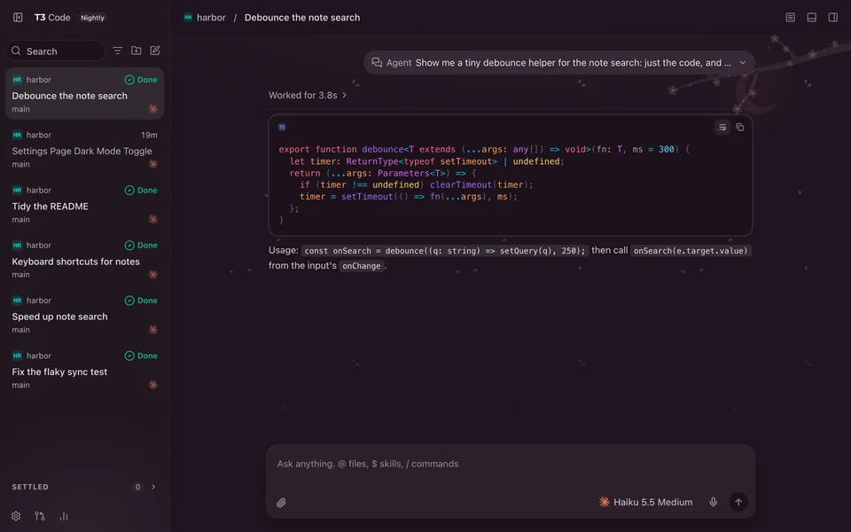</p>

<table>
<tr>
<td width="33%" valign="top">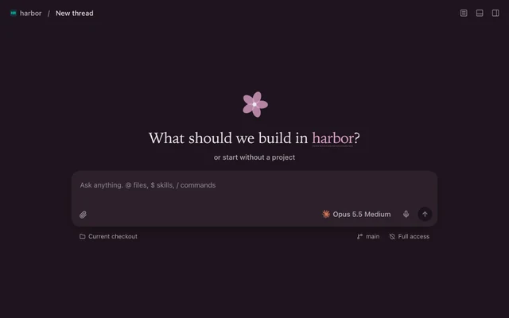<br><b>Living backdrops</b><br><sub>Each theme has a world of its own: blossom, tides, orbits, pixel towns. It moves slowly and holds still when your system asks for less motion.</sub></td>
<td width="33%" valign="top">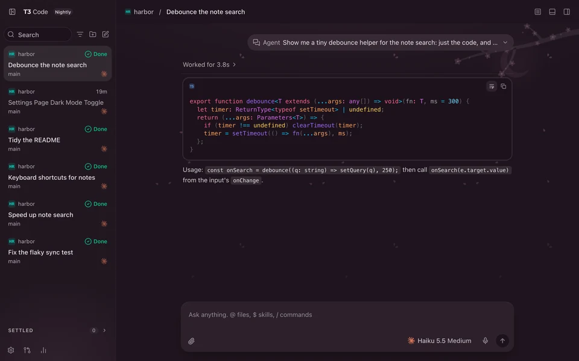<br><b>Dark and light</b><br><sub>Every theme comes in both, and follows T3 Code when it switches.</sub></td>
<td width="33%" valign="top">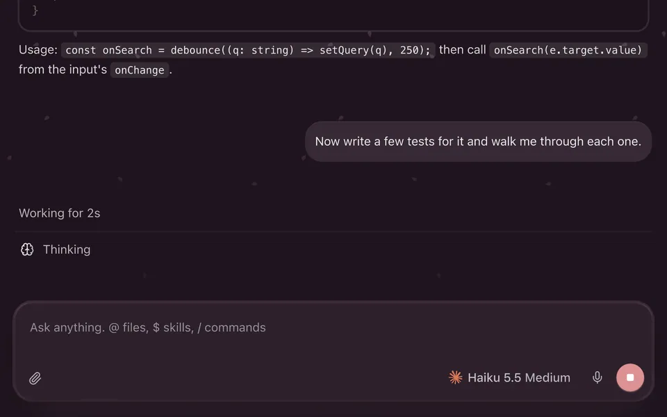<br><b>Alive while the agent works</b><br><sub>A quiet trail runs round the chat bar while an answer is on its way.</sub></td>
</tr>
</table>

> [!NOTE]
> **Unofficial.** A community project, not made by, affiliated with, or endorsed by T3 Code or its makers.

## Install

```sh
curl -fsSL https://raw.githubusercontent.com/mako-code/t3code-themes/main/install.sh | sh
```

That installs the twelve themes pictured below. Then press <kbd>⌘</kbd><kbd>⌥</kbd><kbd>A</kbd> in T3 Code (<kbd>Ctrl</kbd><kbd>Alt</kbd><kbd>A</kbd> on Windows and Linux) and pick one.

- **Other themes:** add their names, as written under each picture: `… | sh -s -- hanami pixel-overworld`
- **No terminal:** download a file from [`themes/`](themes) and add it under **Settings → Appearance → Add theme**.
- **Windows, updating, removing, trouble:** [docs/install.md](docs/install.md)

T3 Code reads at most 32 theme files, so choose the ones you like; the script keeps count.

## The themes

<p align="center">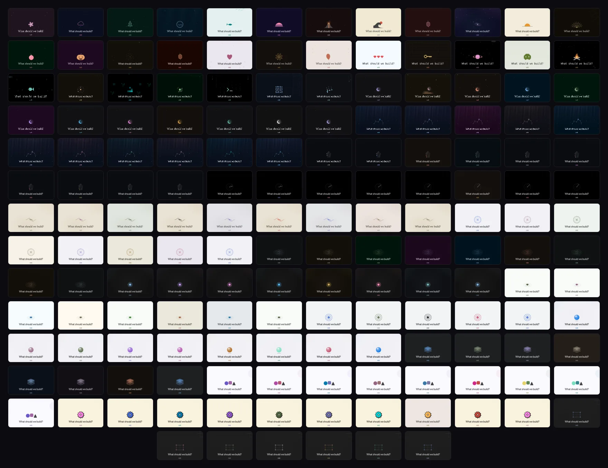</p>

The twelve the install script starts with. Each picture shows the dark side on the left and the light side on the right; the links under it open each side in full.

<table>
<tr><td width="33%" align="center">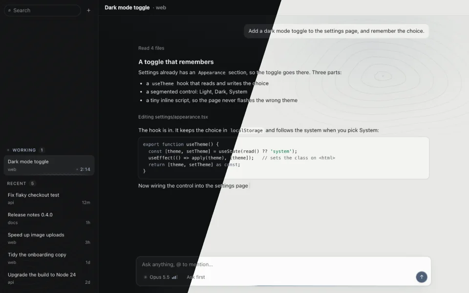<br><b>Classic</b> · <code>classic</code><br><sub><a href="screenshots/somnus-classic/dark.webp">Dark</a> · <a href="screenshots/somnus-classic/light.webp">Light</a></sub></td>
<td width="33%" align="center">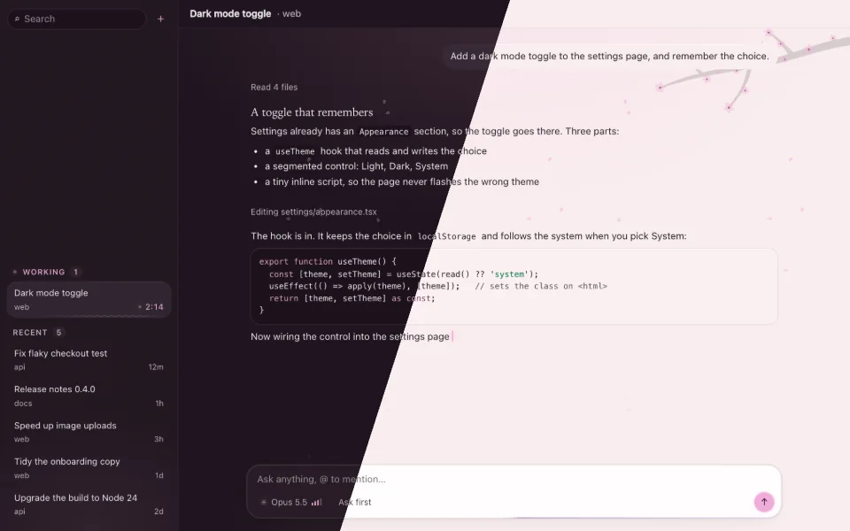<br><b>Hanami</b> · <code>hanami</code><br><sub><a href="screenshots/somnus-hanami/dark.webp">Dark</a> · <a href="screenshots/somnus-hanami/light.webp">Light</a></sub></td>
<td width="33%" align="center">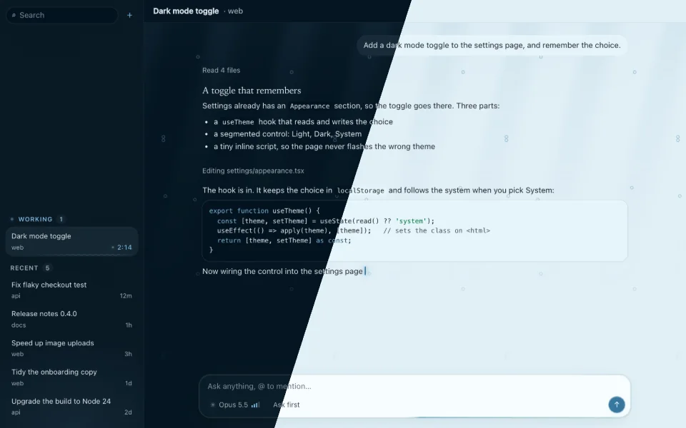<br><b>Tidewater</b> · <code>tidewater</code><br><sub><a href="screenshots/somnus-tidewater/dark.webp">Dark</a> · <a href="screenshots/somnus-tidewater/light.webp">Light</a></sub></td></tr>
<tr><td width="33%" align="center">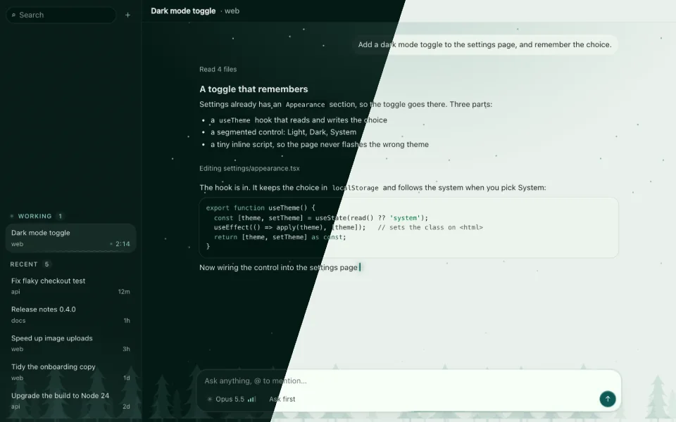<br><b>Evergreen</b> · <code>evergreen</code><br><sub><a href="screenshots/somnus-evergreen/dark.webp">Dark</a> · <a href="screenshots/somnus-evergreen/light.webp">Light</a></sub></td>
<td width="33%" align="center">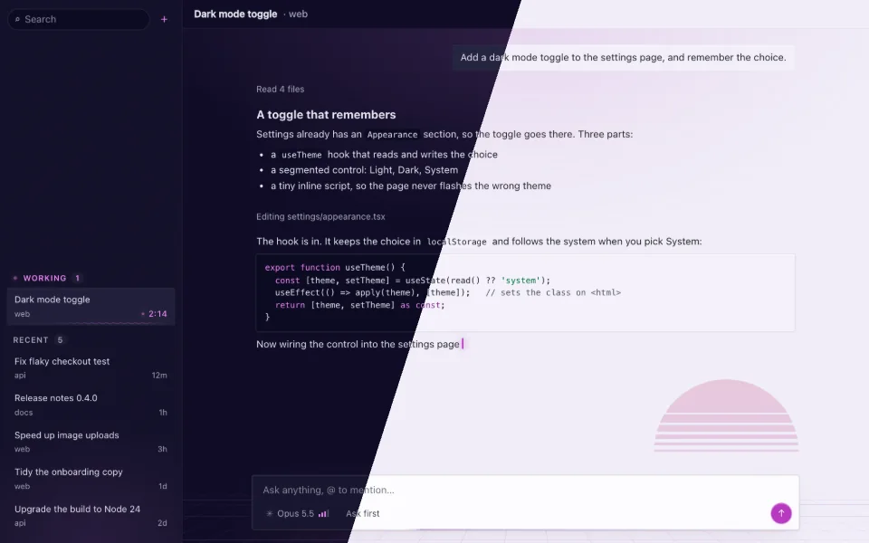<br><b>Laserdisc</b> · <code>laserdisc</code><br><sub><a href="screenshots/somnus-laserdisc/dark.webp">Dark</a> · <a href="screenshots/somnus-laserdisc/light.webp">Light</a></sub></td>
<td width="33%" align="center">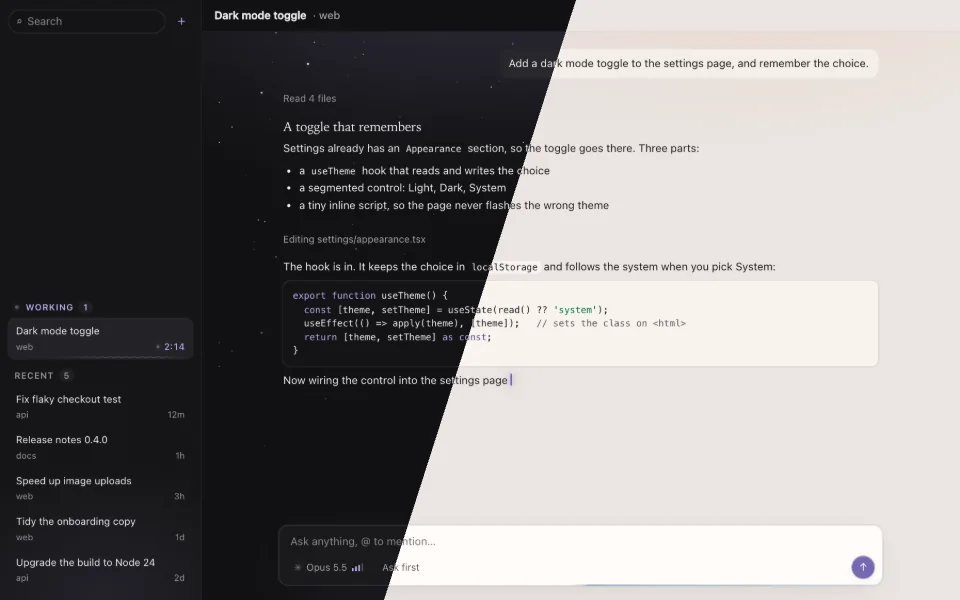<br><b>Insomnia</b> · <code>insomnia</code><br><sub><a href="screenshots/somnus-insomnia/dark.webp">Dark</a> · <a href="screenshots/somnus-insomnia/light.webp">Light</a></sub></td></tr>
<tr><td width="33%" align="center">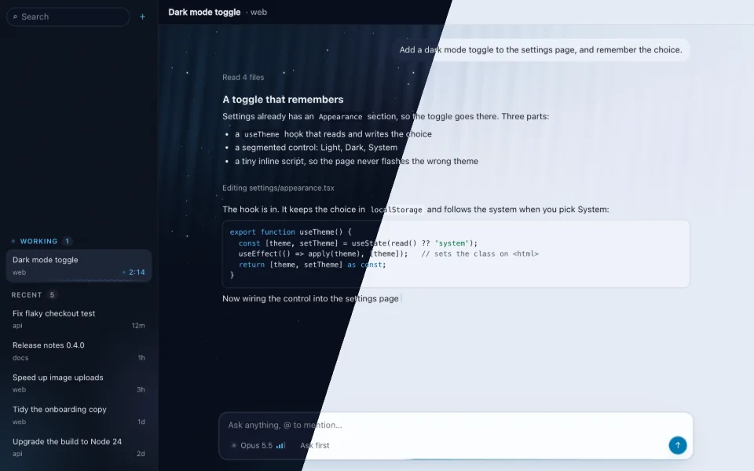<br><b>Nocturne</b> · <code>nocturne</code><br><sub><a href="screenshots/somnus-nocturne/dark.webp">Dark</a> · <a href="screenshots/somnus-nocturne/light.webp">Light</a></sub></td>
<td width="33%" align="center">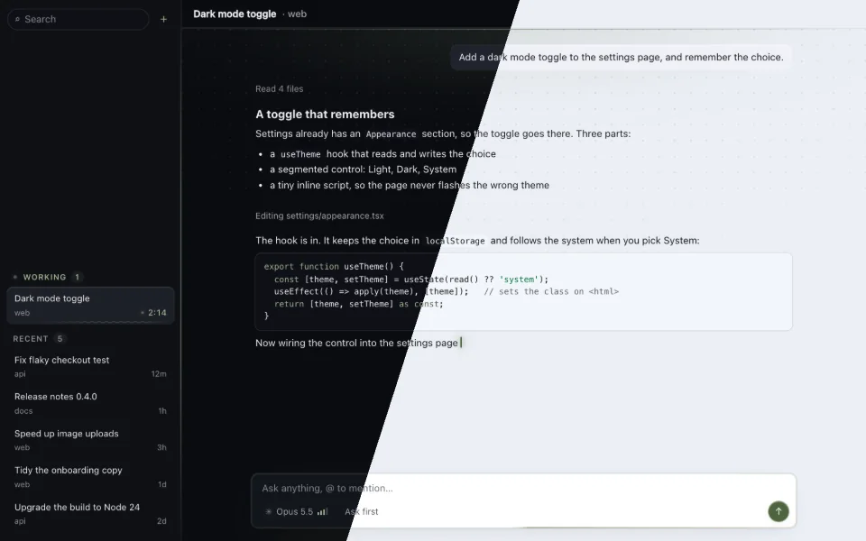<br><b>Obsidian</b> · <code>obsidian</code><br><sub><a href="screenshots/somnus-obsidian/dark.webp">Dark</a> · <a href="screenshots/somnus-obsidian/light.webp">Light</a></sub></td>
<td width="33%" align="center"><br><b>Vellum</b> · <code>vellum</code><br><sub><a href="screenshots/somnus-vellum/dark.webp">Dark</a> · <a href="screenshots/somnus-vellum/light.webp">Light</a></sub></td></tr>
<tr><td width="33%" align="center"><br><b>Porcelain</b> · <code>porcelain</code><br><sub><a href="screenshots/somnus-porcelain/dark.webp">Dark</a> · <a href="screenshots/somnus-porcelain/light.webp">Light</a></sub></td>
<td width="33%" align="center">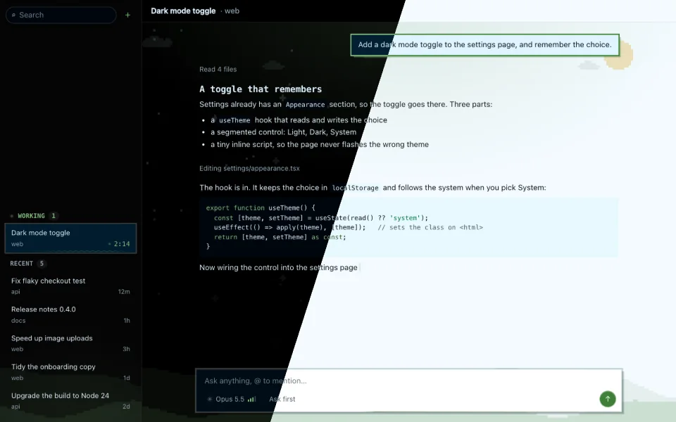<br><b>Pixel Overworld</b> · <code>pixel-overworld</code><br><sub><a href="screenshots/somnus-pixel-overworld/dark.webp">Dark</a> · <a href="screenshots/somnus-pixel-overworld/light.webp">Light</a></sub></td>
<td width="33%" align="center">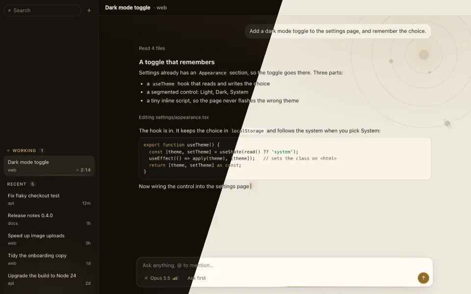<br><b>Orrery</b> · <code>orrery</code><br><sub><a href="screenshots/somnus-orrery/dark.webp">Dark</a> · <a href="screenshots/somnus-orrery/light.webp">Light</a></sub></td></tr>
</table>

All 162, by family, with the name to install each by:

### Scenes · 12

Twelve one-of-a-kind themes.

<table>
<tr><td width="33%" align="center"><br><b>Hanami</b> · <code>hanami</code><br><sub><a href="screenshots/somnus-hanami/dark.webp">Dark</a> · <a href="screenshots/somnus-hanami/light.webp">Light</a></sub></td>
<td width="33%" align="center">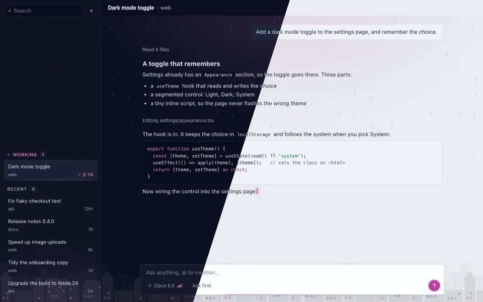<br><b>Rainlight</b> · <code>rainlight</code><br><sub><a href="screenshots/somnus-rainlight/dark.webp">Dark</a> · <a href="screenshots/somnus-rainlight/light.webp">Light</a></sub></td>
<td width="33%" align="center"><br><b>Evergreen</b> · <code>evergreen</code><br><sub><a href="screenshots/somnus-evergreen/dark.webp">Dark</a> · <a href="screenshots/somnus-evergreen/light.webp">Light</a></sub></td></tr>
<tr><td width="33%" align="center"><br><b>Tidewater</b> · <code>tidewater</code><br><sub><a href="screenshots/somnus-tidewater/dark.webp">Dark</a> · <a href="screenshots/somnus-tidewater/light.webp">Light</a></sub></td>
<td width="33%" align="center">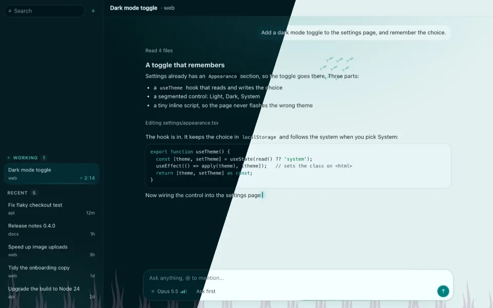<br><b>Atoll</b> · <code>atoll</code><br><sub><a href="screenshots/somnus-atoll/dark.webp">Dark</a> · <a href="screenshots/somnus-atoll/light.webp">Light</a></sub></td>
<td width="33%" align="center"><br><b>Laserdisc</b> · <code>laserdisc</code><br><sub><a href="screenshots/somnus-laserdisc/dark.webp">Dark</a> · <a href="screenshots/somnus-laserdisc/light.webp">Light</a></sub></td></tr>
<tr><td width="33%" align="center">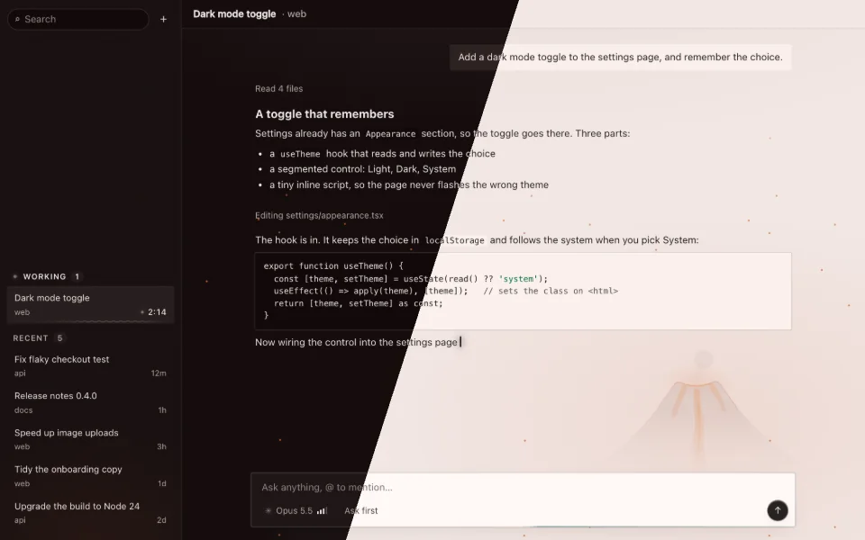<br><b>Basalt</b> · <code>basalt</code><br><sub><a href="screenshots/somnus-basalt/dark.webp">Dark</a> · <a href="screenshots/somnus-basalt/light.webp">Light</a></sub></td>
<td width="33%" align="center">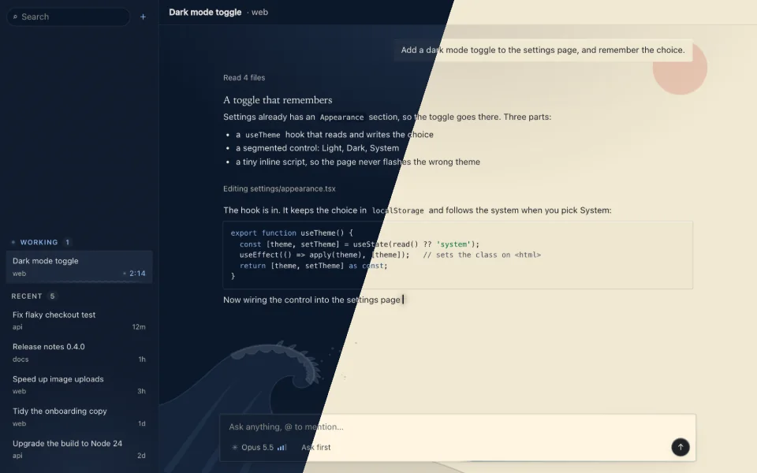<br><b>Ukiyo</b> · <code>ukiyo</code><br><sub><a href="screenshots/somnus-ukiyo/dark.webp">Dark</a> · <a href="screenshots/somnus-ukiyo/light.webp">Light</a></sub></td>
<td width="33%" align="center">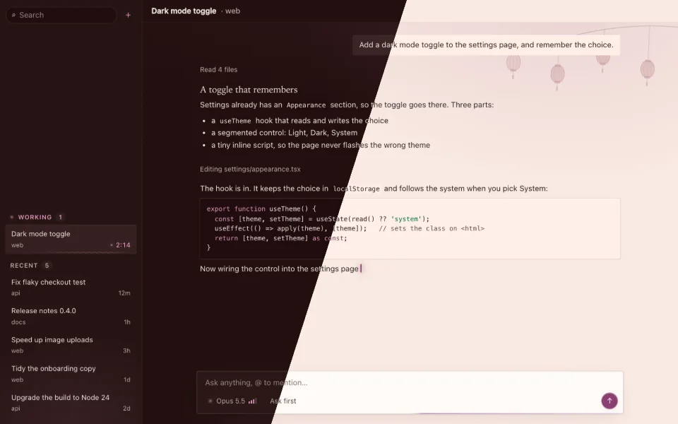<br><b>Lanternlight</b> · <code>lanternlight</code><br><sub><a href="screenshots/somnus-lanternlight/dark.webp">Dark</a> · <a href="screenshots/somnus-lanternlight/light.webp">Light</a></sub></td></tr>
<tr><td width="33%" align="center">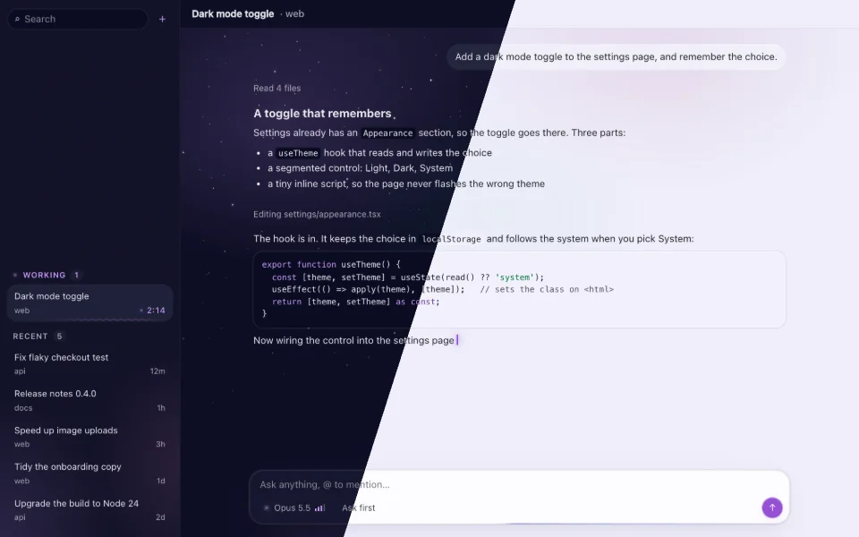<br><b>Deepfield</b> · <code>deepfield</code><br><sub><a href="screenshots/somnus-deepfield/dark.webp">Dark</a> · <a href="screenshots/somnus-deepfield/light.webp">Light</a></sub></td>
<td width="33%" align="center">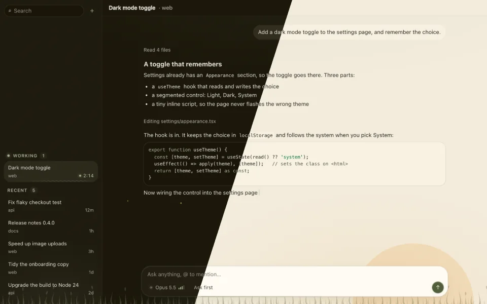<br><b>Midsummer</b> · <code>midsummer</code><br><sub><a href="screenshots/somnus-midsummer/dark.webp">Dark</a> · <a href="screenshots/somnus-midsummer/light.webp">Light</a></sub></td>
<td width="33%" align="center">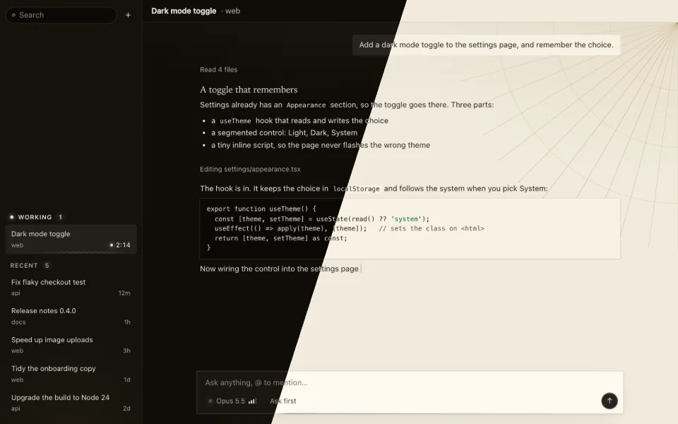<br><b>Gilded</b> · <code>gilded</code><br><sub><a href="screenshots/somnus-gilded/dark.webp">Dark</a> · <a href="screenshots/somnus-gilded/light.webp">Light</a></sub></td></tr>
</table>

### Festive · 7

For the season, whichever it is.

<table>
<tr><td width="33%" align="center">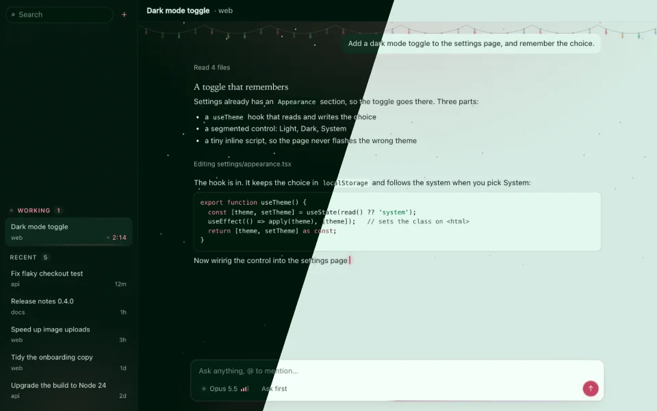<br><b>Yuletide</b> · <code>yuletide</code><br><sub><a href="screenshots/somnus-yuletide/dark.webp">Dark</a> · <a href="screenshots/somnus-yuletide/light.webp">Light</a></sub></td>
<td width="33%" align="center">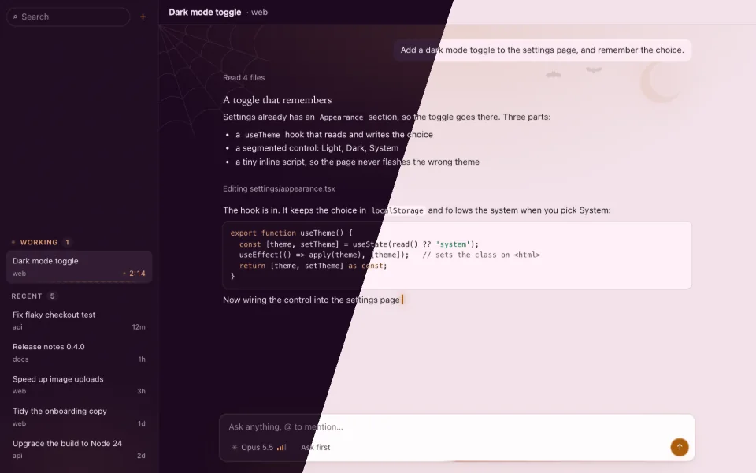<br><b>Hallows</b> · <code>hallows</code><br><sub><a href="screenshots/somnus-hallows/dark.webp">Dark</a> · <a href="screenshots/somnus-hallows/light.webp">Light</a></sub></td>
<td width="33%" align="center">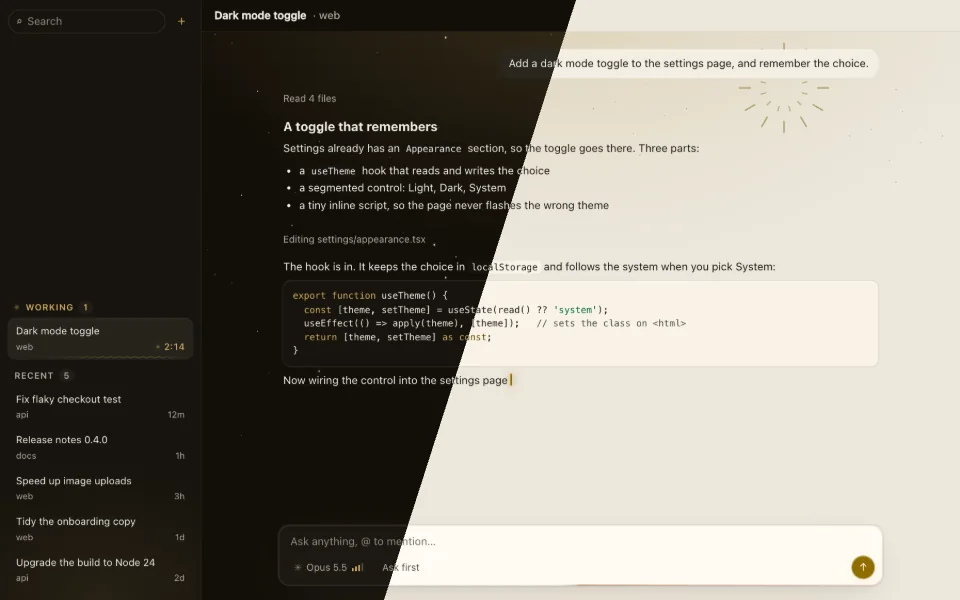<br><b>Countdown</b> · <code>countdown</code><br><sub><a href="screenshots/somnus-countdown/dark.webp">Dark</a> · <a href="screenshots/somnus-countdown/light.webp">Light</a></sub></td></tr>
<tr><td width="33%" align="center">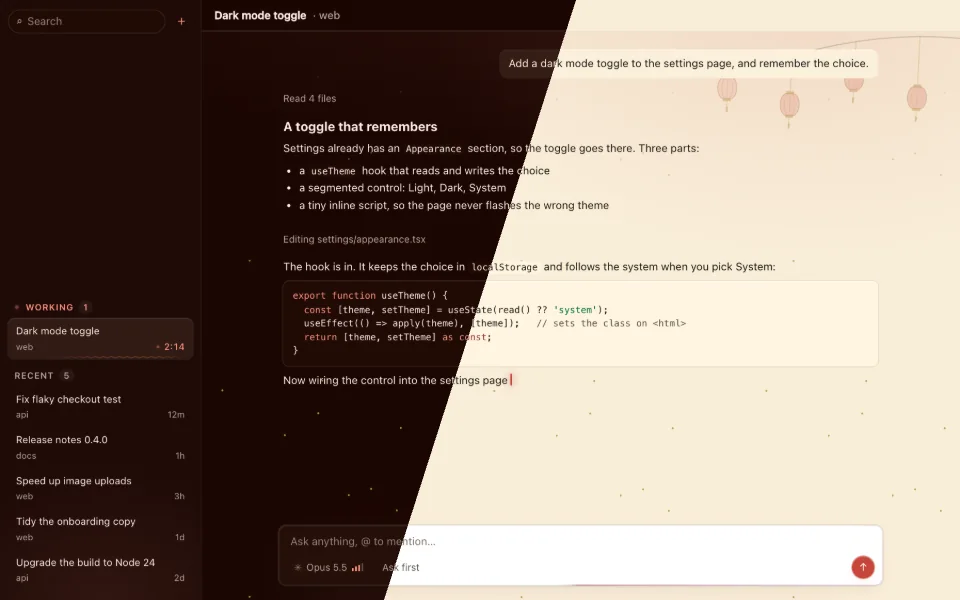<br><b>Lunar</b> · <code>lunar</code><br><sub><a href="screenshots/somnus-lunar/dark.webp">Dark</a> · <a href="screenshots/somnus-lunar/light.webp">Light</a></sub></td>
<td width="33%" align="center">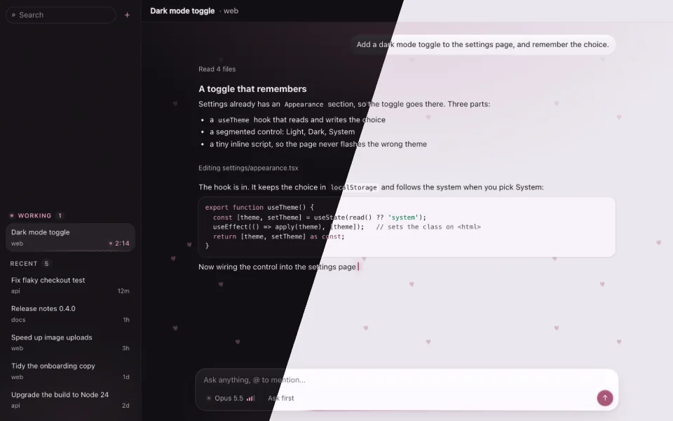<br><b>Valentine</b> · <code>valentine</code><br><sub><a href="screenshots/somnus-valentine/dark.webp">Dark</a> · <a href="screenshots/somnus-valentine/light.webp">Light</a></sub></td>
<td width="33%" align="center">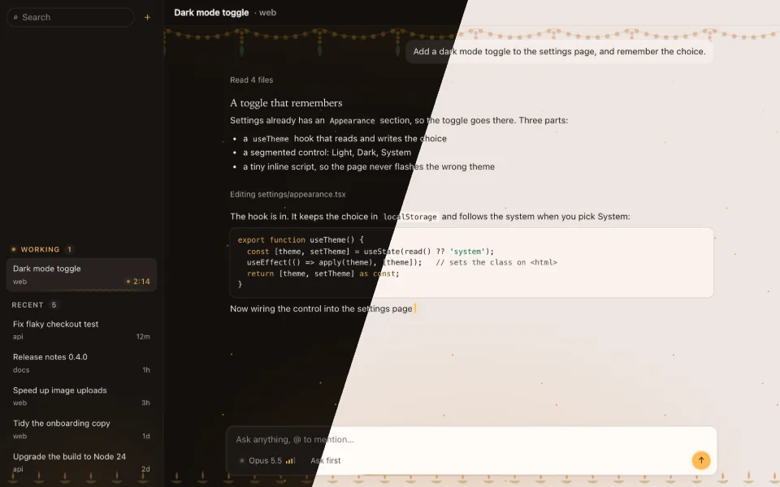<br><b>Diwali</b> · <code>diwali</code><br><sub><a href="screenshots/somnus-diwali/dark.webp">Dark</a> · <a href="screenshots/somnus-diwali/light.webp">Light</a></sub></td></tr>
<tr><td width="33%" align="center">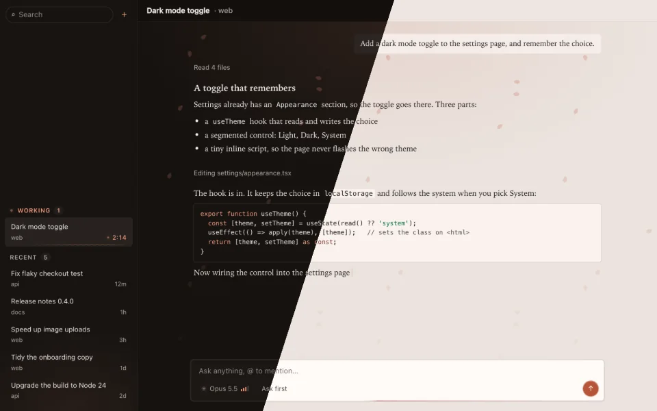<br><b>Harvest</b> · <code>harvest</code><br><sub><a href="screenshots/somnus-harvest/dark.webp">Dark</a> · <a href="screenshots/somnus-harvest/light.webp">Light</a></sub></td>
<td width="33%"></td>
<td width="33%"></td></tr>
</table>

### Pixel · 6

Eight-bit worlds, drawn a square at a time on a 4 px grid: square corners, hard shadows, headings in mono, and pixel art that moves behind the chat.

<table>
<tr><td width="33%" align="center"><br><b>Pixel Overworld</b> · <code>pixel-overworld</code><br><sub><a href="screenshots/somnus-pixel-overworld/dark.webp">Dark</a> · <a href="screenshots/somnus-pixel-overworld/light.webp">Light</a></sub></td>
<td width="33%" align="center">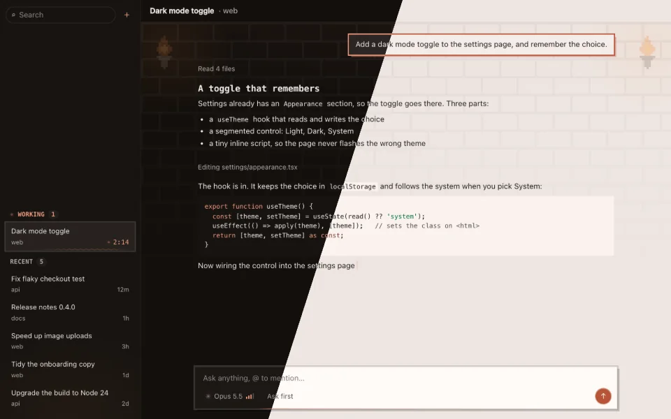<br><b>Pixel Dungeon</b> · <code>pixel-dungeon</code><br><sub><a href="screenshots/somnus-pixel-dungeon/dark.webp">Dark</a> · <a href="screenshots/somnus-pixel-dungeon/light.webp">Light</a></sub></td>
<td width="33%" align="center">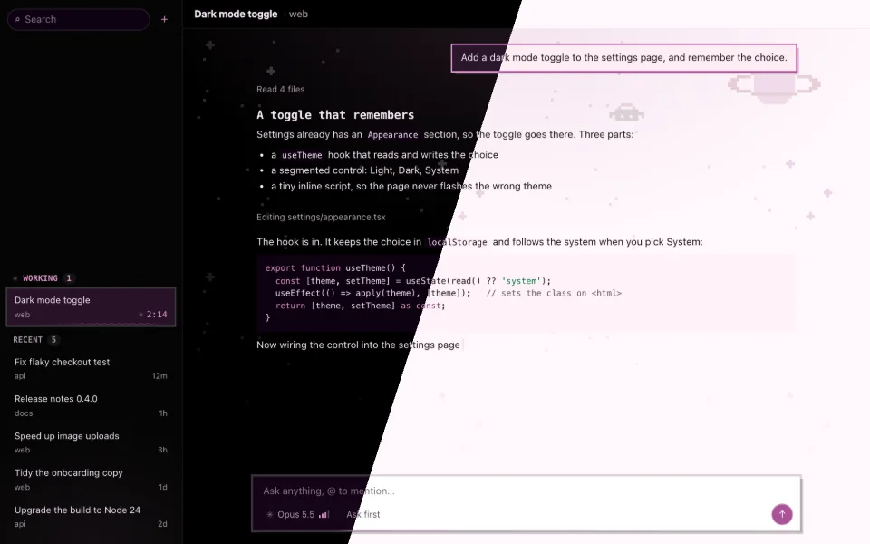<br><b>Pixel Cosmos</b> · <code>pixel-cosmos</code><br><sub><a href="screenshots/somnus-pixel-cosmos/dark.webp">Dark</a> · <a href="screenshots/somnus-pixel-cosmos/light.webp">Light</a></sub></td></tr>
<tr><td width="33%" align="center">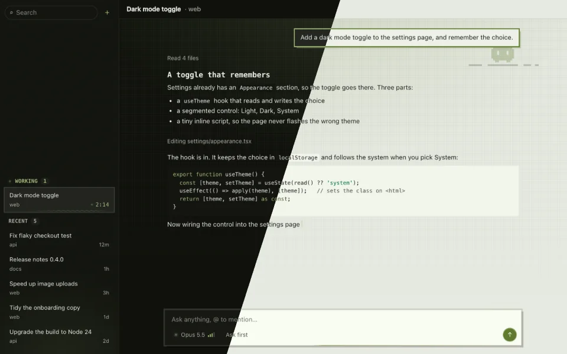<br><b>Pixel Pocket</b> · <code>pixel-pocket</code><br><sub><a href="screenshots/somnus-pixel-pocket/dark.webp">Dark</a> · <a href="screenshots/somnus-pixel-pocket/light.webp">Light</a></sub></td>
<td width="33%" align="center">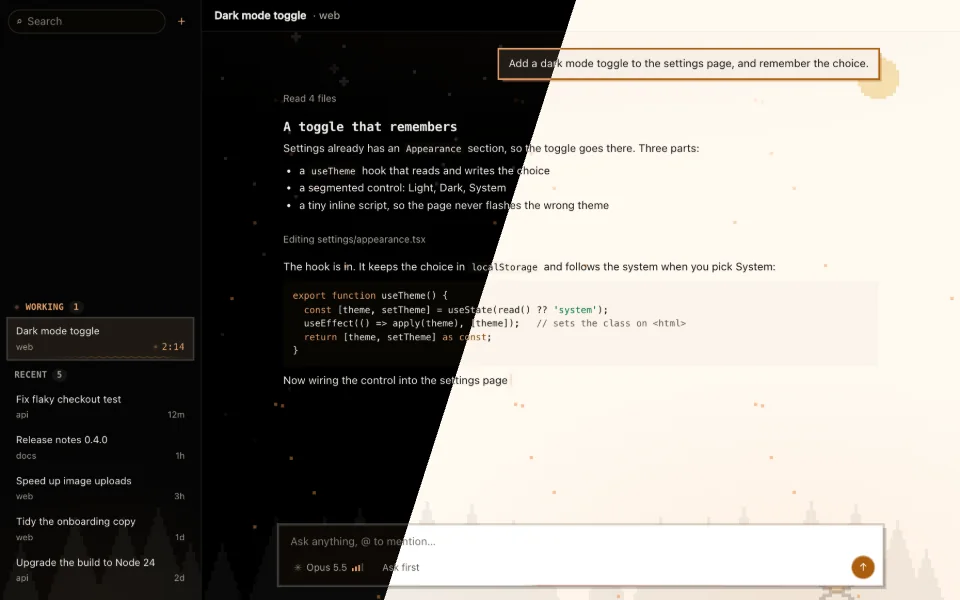<br><b>Pixel Campfire</b> · <code>pixel-campfire</code><br><sub><a href="screenshots/somnus-pixel-campfire/dark.webp">Dark</a> · <a href="screenshots/somnus-pixel-campfire/light.webp">Light</a></sub></td>
<td width="33%" align="center">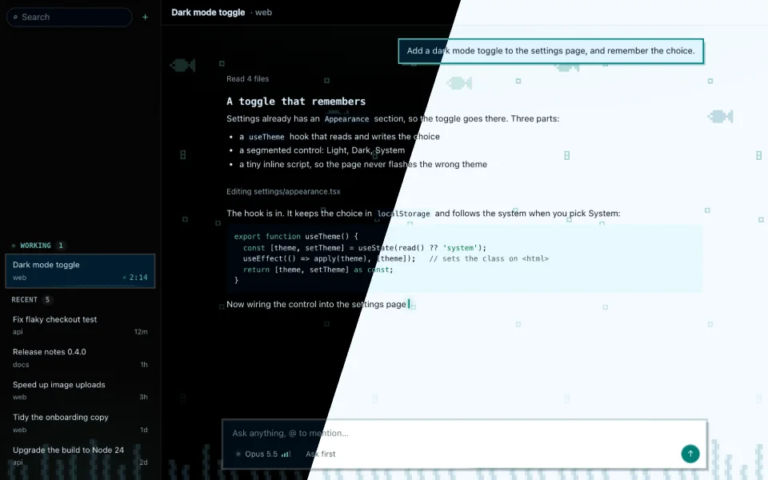<br><b>Pixel Reef</b> · <code>pixel-reef</code><br><sub><a href="screenshots/somnus-pixel-reef/dark.webp">Dark</a> · <a href="screenshots/somnus-pixel-reef/light.webp">Light</a></sub></td></tr>
</table>

### Lab · 6

For the nerds: an orrery, Conway's Life, a circuit board, falling hex, a Hilbert curve and a pendulum wave.

<table>
<tr><td width="33%" align="center"><br><b>Orrery</b> · <code>orrery</code><br><sub><a href="screenshots/somnus-orrery/dark.webp">Dark</a> · <a href="screenshots/somnus-orrery/light.webp">Light</a></sub></td>
<td width="33%" align="center">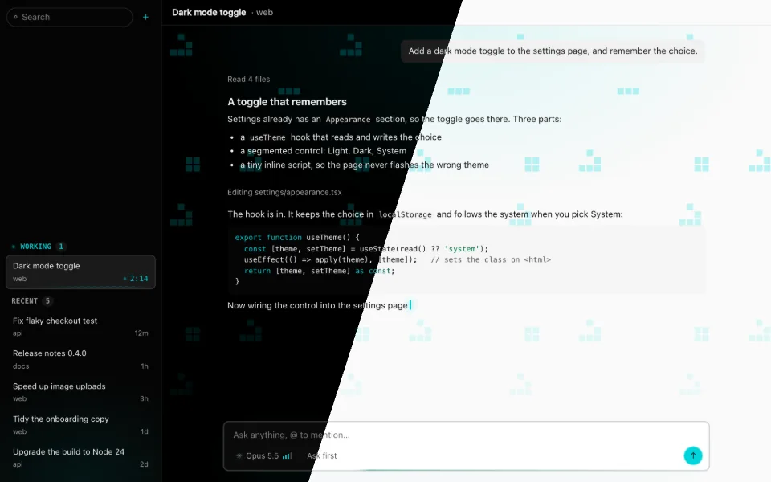<br><b>Automata</b> · <code>automata</code><br><sub><a href="screenshots/somnus-automata/dark.webp">Dark</a> · <a href="screenshots/somnus-automata/light.webp">Light</a></sub></td>
<td width="33%" align="center">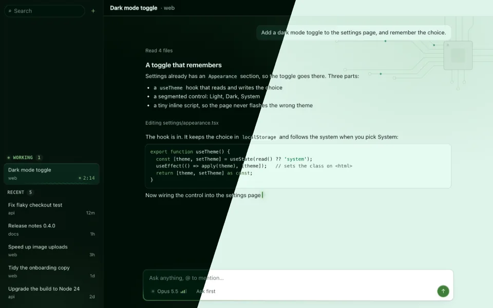<br><b>Circuit</b> · <code>circuit</code><br><sub><a href="screenshots/somnus-circuit/dark.webp">Dark</a> · <a href="screenshots/somnus-circuit/light.webp">Light</a></sub></td></tr>
<tr><td width="33%" align="center">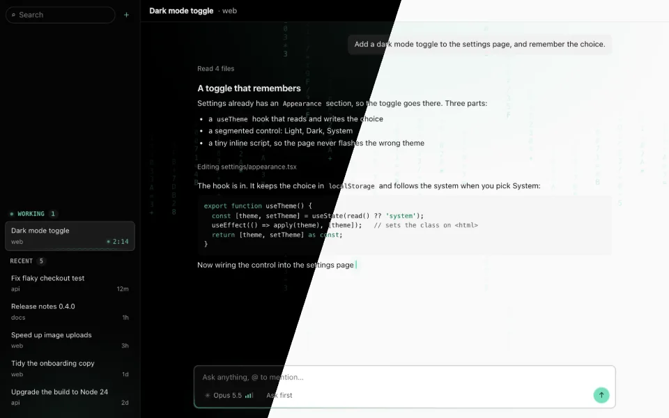<br><b>Cascade</b> · <code>cascade</code><br><sub><a href="screenshots/somnus-cascade/dark.webp">Dark</a> · <a href="screenshots/somnus-cascade/light.webp">Light</a></sub></td>
<td width="33%" align="center">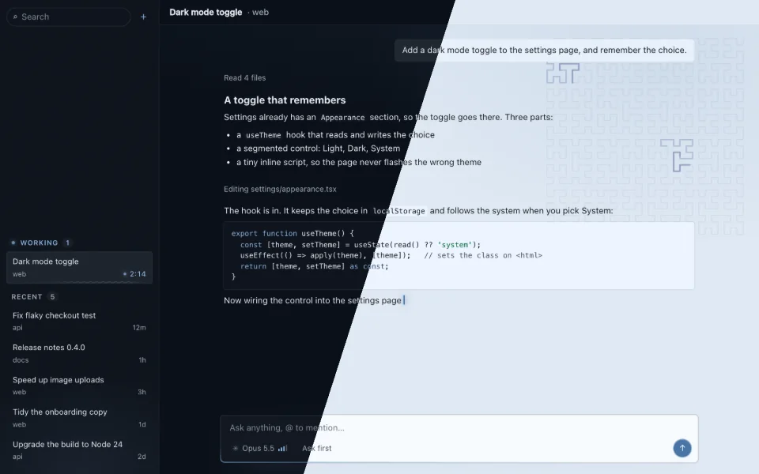<br><b>Hilbert</b> · <code>hilbert</code><br><sub><a href="screenshots/somnus-hilbert/dark.webp">Dark</a> · <a href="screenshots/somnus-hilbert/light.webp">Light</a></sub></td>
<td width="33%" align="center">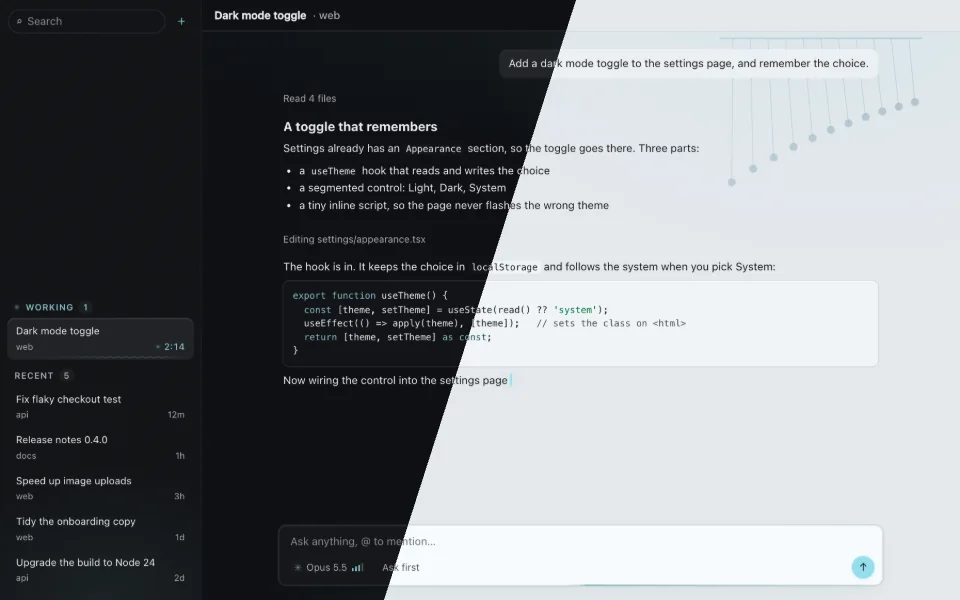<br><b>Harmonic</b> · <code>harmonic</code><br><sub><a href="screenshots/somnus-harmonic/dark.webp">Dark</a> · <a href="screenshots/somnus-harmonic/light.webp">Light</a></sub></td></tr>
</table>

### Insomnia · 12

The flagship: the look of Insomnia itself, the app these themes take their motion from.

<table>
<tr><td width="33%" align="center"><br><b>Insomnia</b> · <code>insomnia</code><br><sub><a href="screenshots/somnus-insomnia/dark.webp">Dark</a> · <a href="screenshots/somnus-insomnia/light.webp">Light</a></sub></td>
<td width="33%" align="center">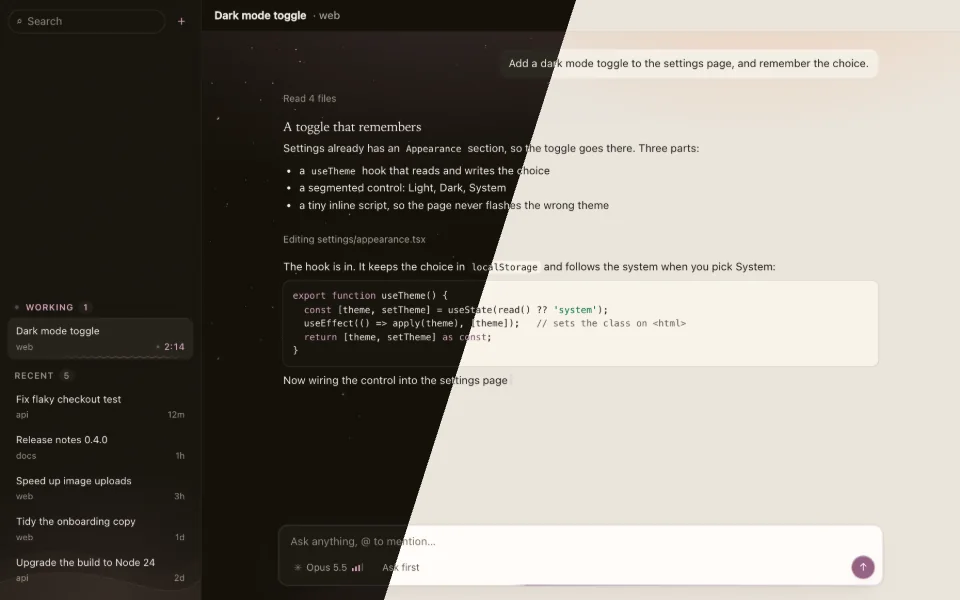<br><b>Insomnia Dune</b> · <code>insomnia-dune</code><br><sub><a href="screenshots/somnus-insomnia-dune/dark.webp">Dark</a> · <a href="screenshots/somnus-insomnia-dune/light.webp">Light</a></sub></td>
<td width="33%" align="center">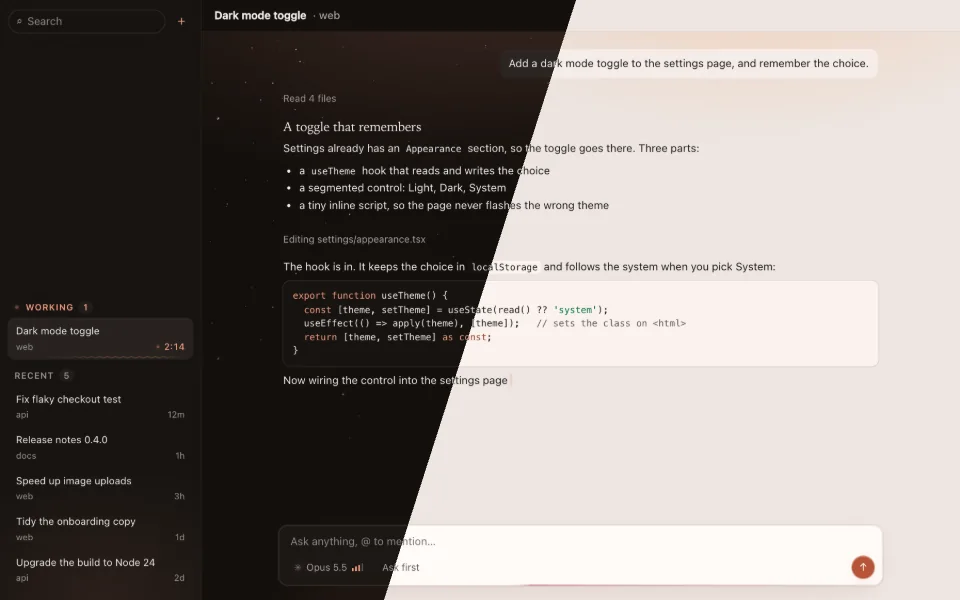<br><b>Insomnia Ember</b> · <code>insomnia-ember</code><br><sub><a href="screenshots/somnus-insomnia-ember/dark.webp">Dark</a> · <a href="screenshots/somnus-insomnia-ember/light.webp">Light</a></sub></td></tr>
<tr><td width="33%" align="center">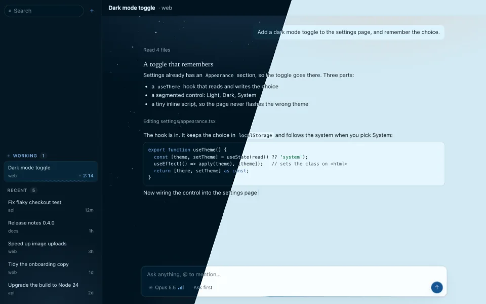<br><b>Insomnia Deep Sea</b> · <code>insomnia-deep-sea</code><br><sub><a href="screenshots/somnus-insomnia-deep-sea/dark.webp">Dark</a> · <a href="screenshots/somnus-insomnia-deep-sea/light.webp">Light</a></sub></td>
<td width="33%" align="center">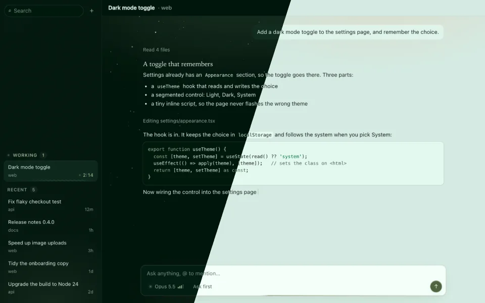<br><b>Insomnia Pine</b> · <code>insomnia-pine</code><br><sub><a href="screenshots/somnus-insomnia-pine/dark.webp">Dark</a> · <a href="screenshots/somnus-insomnia-pine/light.webp">Light</a></sub></td>
<td width="33%" align="center">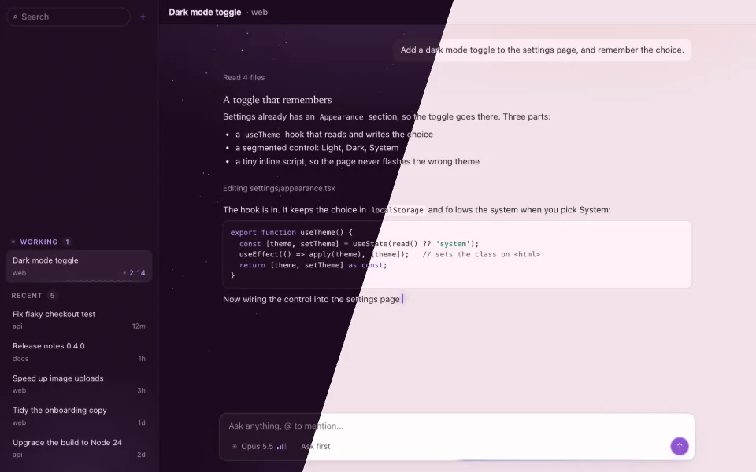<br><b>Insomnia Plum</b> · <code>insomnia-plum</code><br><sub><a href="screenshots/somnus-insomnia-plum/dark.webp">Dark</a> · <a href="screenshots/somnus-insomnia-plum/light.webp">Light</a></sub></td></tr>
<tr><td width="33%" align="center">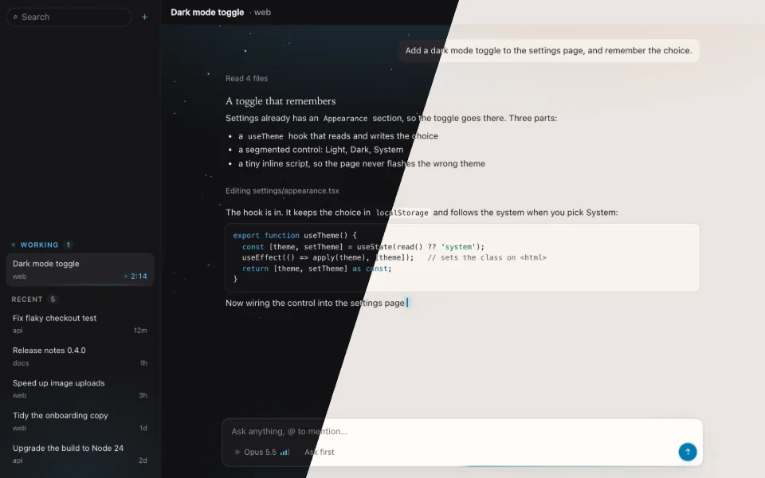<br><b>Insomnia Aurora</b> · <code>insomnia-aurora</code><br><sub><a href="screenshots/somnus-insomnia-aurora/dark.webp">Dark</a> · <a href="screenshots/somnus-insomnia-aurora/light.webp">Light</a></sub></td>
<td width="33%" align="center">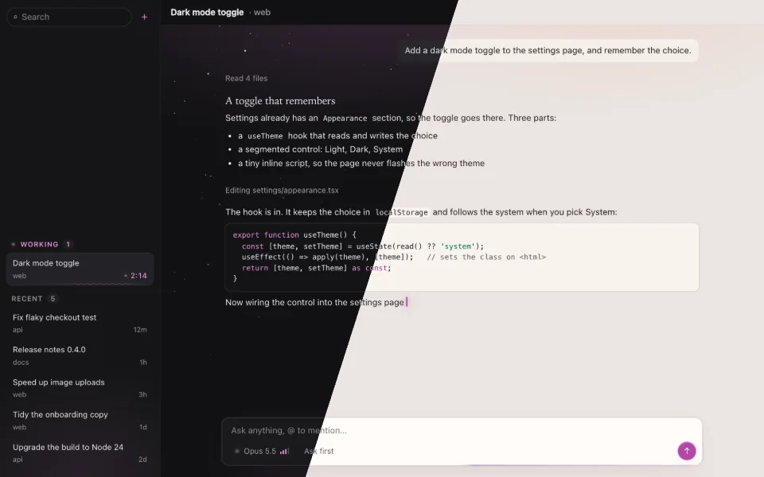<br><b>Insomnia Sunset</b> · <code>insomnia-sunset</code><br><sub><a href="screenshots/somnus-insomnia-sunset/dark.webp">Dark</a> · <a href="screenshots/somnus-insomnia-sunset/light.webp">Light</a></sub></td>
<td width="33%" align="center">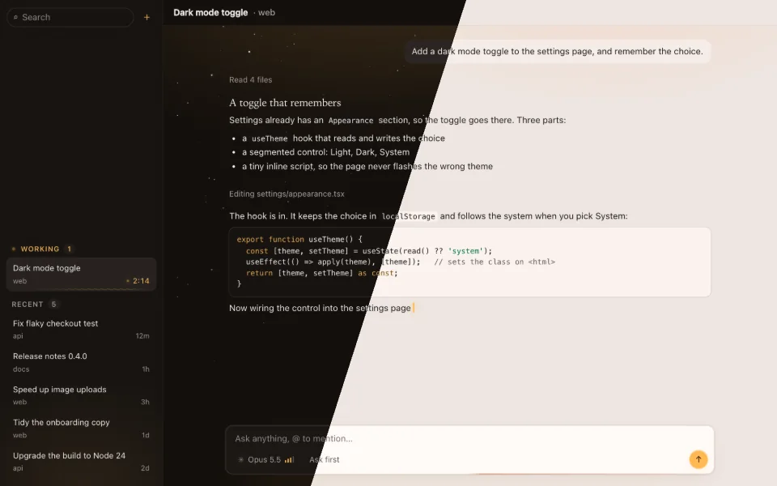<br><b>Insomnia Amber</b> · <code>insomnia-amber</code><br><sub><a href="screenshots/somnus-insomnia-amber/dark.webp">Dark</a> · <a href="screenshots/somnus-insomnia-amber/light.webp">Light</a></sub></td></tr>
<tr><td width="33%" align="center">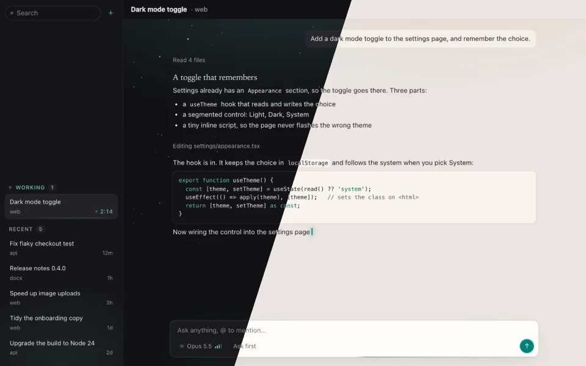<br><b>Insomnia Lagoon</b> · <code>insomnia-lagoon</code><br><sub><a href="screenshots/somnus-insomnia-lagoon/dark.webp">Dark</a> · <a href="screenshots/somnus-insomnia-lagoon/light.webp">Light</a></sub></td>
<td width="33%" align="center">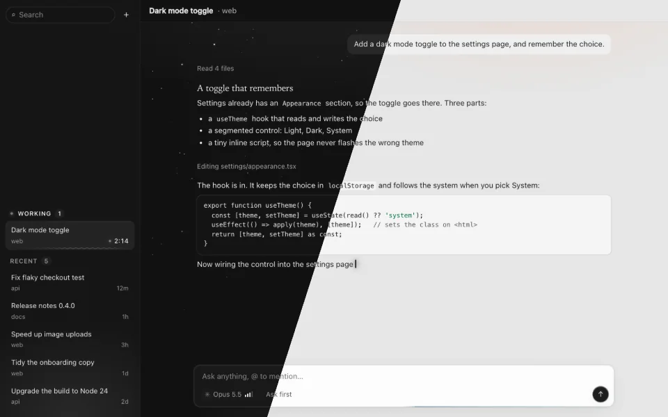<br><b>Insomnia Graphite</b> · <code>insomnia-graphite</code><br><sub><a href="screenshots/somnus-insomnia-graphite/dark.webp">Dark</a> · <a href="screenshots/somnus-insomnia-graphite/light.webp">Light</a></sub></td>
<td width="33%" align="center"><br><b>Insomnia High Contrast</b> · <code>insomnia-high-contrast</code><br><sub><a href="screenshots/somnus-insomnia-high-contrast/dark.webp">Dark</a> · <a href="screenshots/somnus-insomnia-high-contrast/light.webp">Light</a></sub></td></tr>
</table>

### Nocturne · 11

The cinematic one.

<table>
<tr><td width="33%" align="center"><br><b>Nocturne</b> · <code>nocturne</code><br><sub><a href="screenshots/somnus-nocturne/dark.webp">Dark</a> · <a href="screenshots/somnus-nocturne/light.webp">Light</a></sub></td>
<td width="33%" align="center"><br><b>Nocturne Cobalt</b> · <code>nocturne-cobalt</code><br><sub><a href="screenshots/somnus-nocturne-cobalt/dark.webp">Dark</a> · <a href="screenshots/somnus-nocturne-cobalt/light.webp">Light</a></sub></td>
<td width="33%" align="center"><br><b>Nocturne Prism</b> · <code>nocturne-prism</code><br><sub><a href="screenshots/somnus-nocturne-prism/dark.webp">Dark</a> · <a href="screenshots/somnus-nocturne-prism/light.webp">Light</a></sub></td></tr>
<tr><td width="33%" align="center"><br><b>Nocturne Rose</b> · <code>nocturne-rose</code><br><sub><a href="screenshots/somnus-nocturne-rose/dark.webp">Dark</a> · <a href="screenshots/somnus-nocturne-rose/light.webp">Light</a></sub></td>
<td width="33%" align="center"><br><b>Nocturne Deep Sea</b> · <code>nocturne-deep-sea</code><br><sub><a href="screenshots/somnus-nocturne-deep-sea/dark.webp">Dark</a> · <a href="screenshots/somnus-nocturne-deep-sea/light.webp">Light</a></sub></td>
<td width="33%" align="center"><br><b>Nocturne Holo</b> · <code>nocturne-holo</code><br><sub><a href="screenshots/somnus-nocturne-holo/dark.webp">Dark</a> · <a href="screenshots/somnus-nocturne-holo/light.webp">Light</a></sub></td></tr>
<tr><td width="33%" align="center"><br><b>Nocturne Sunset</b> · <code>nocturne-sunset</code><br><sub><a href="screenshots/somnus-nocturne-sunset/dark.webp">Dark</a> · <a href="screenshots/somnus-nocturne-sunset/light.webp">Light</a></sub></td>
<td width="33%" align="center"><br><b>Nocturne Mint</b> · <code>nocturne-mint</code><br><sub><a href="screenshots/somnus-nocturne-mint/dark.webp">Dark</a> · <a href="screenshots/somnus-nocturne-mint/light.webp">Light</a></sub></td>
<td width="33%" align="center"><br><b>Nocturne Orchid</b> · <code>nocturne-orchid</code><br><sub><a href="screenshots/somnus-nocturne-orchid/dark.webp">Dark</a> · <a href="screenshots/somnus-nocturne-orchid/light.webp">Light</a></sub></td></tr>
<tr><td width="33%" align="center"><br><b>Nocturne Neon</b> · <code>nocturne-neon</code><br><sub><a href="screenshots/somnus-nocturne-neon/dark.webp">Dark</a> · <a href="screenshots/somnus-nocturne-neon/light.webp">Light</a></sub></td>
<td width="33%" align="center"><br><b>Nocturne High Contrast</b> · <code>nocturne-high-contrast</code><br><sub><a href="screenshots/somnus-nocturne-high-contrast/dark.webp">Dark</a> · <a href="screenshots/somnus-nocturne-high-contrast/light.webp">Light</a></sub></td>
<td width="33%"></td></tr>
</table>

### Obsidian · 10

Blue-black glass with lit edges.

<table>
<tr><td width="33%" align="center"><br><b>Obsidian</b> · <code>obsidian</code><br><sub><a href="screenshots/somnus-obsidian/dark.webp">Dark</a> · <a href="screenshots/somnus-obsidian/light.webp">Light</a></sub></td>
<td width="33%" align="center"><br><b>Obsidian Cobalt</b> · <code>obsidian-cobalt</code><br><sub><a href="screenshots/somnus-obsidian-cobalt/dark.webp">Dark</a> · <a href="screenshots/somnus-obsidian-cobalt/light.webp">Light</a></sub></td>
<td width="33%" align="center"><br><b>Obsidian Ember</b> · <code>obsidian-ember</code><br><sub><a href="screenshots/somnus-obsidian-ember/dark.webp">Dark</a> · <a href="screenshots/somnus-obsidian-ember/light.webp">Light</a></sub></td></tr>
<tr><td width="33%" align="center"><br><b>Obsidian Slate</b> · <code>obsidian-slate</code><br><sub><a href="screenshots/somnus-obsidian-slate/dark.webp">Dark</a> · <a href="screenshots/somnus-obsidian-slate/light.webp">Light</a></sub></td>
<td width="33%" align="center"><br><b>Obsidian Holo</b> · <code>obsidian-holo</code><br><sub><a href="screenshots/somnus-obsidian-holo/dark.webp">Dark</a> · <a href="screenshots/somnus-obsidian-holo/light.webp">Light</a></sub></td>
<td width="33%" align="center"><br><b>Obsidian Sunset</b> · <code>obsidian-sunset</code><br><sub><a href="screenshots/somnus-obsidian-sunset/dark.webp">Dark</a> · <a href="screenshots/somnus-obsidian-sunset/light.webp">Light</a></sub></td></tr>
<tr><td width="33%" align="center"><br><b>Obsidian Ruby</b> · <code>obsidian-ruby</code><br><sub><a href="screenshots/somnus-obsidian-ruby/dark.webp">Dark</a> · <a href="screenshots/somnus-obsidian-ruby/light.webp">Light</a></sub></td>
<td width="33%" align="center"><br><b>Obsidian Citrine</b> · <code>obsidian-citrine</code><br><sub><a href="screenshots/somnus-obsidian-citrine/dark.webp">Dark</a> · <a href="screenshots/somnus-obsidian-citrine/light.webp">Light</a></sub></td>
<td width="33%" align="center"><br><b>Obsidian Mint</b> · <code>obsidian-mint</code><br><sub><a href="screenshots/somnus-obsidian-mint/dark.webp">Dark</a> · <a href="screenshots/somnus-obsidian-mint/light.webp">Light</a></sub></td></tr>
<tr><td width="33%" align="center"><br><b>Obsidian High Contrast</b> · <code>obsidian-high-contrast</code><br><sub><a href="screenshots/somnus-obsidian-high-contrast/dark.webp">Dark</a> · <a href="screenshots/somnus-obsidian-high-contrast/light.webp">Light</a></sub></td>
<td width="33%"></td>
<td width="33%"></td></tr>
</table>

### Carbon · 8

True black and white, lines only, labels in mono.

<table>
<tr><td width="33%" align="center"><br><b>Carbon</b> · <code>carbon</code><br><sub><a href="screenshots/somnus-carbon/dark.webp">Dark</a> · <a href="screenshots/somnus-carbon/light.webp">Light</a></sub></td>
<td width="33%" align="center"><br><b>Carbon Cobalt</b> · <code>carbon-cobalt</code><br><sub><a href="screenshots/somnus-carbon-cobalt/dark.webp">Dark</a> · <a href="screenshots/somnus-carbon-cobalt/light.webp">Light</a></sub></td>
<td width="33%" align="center"><br><b>Carbon Magenta</b> · <code>carbon-magenta</code><br><sub><a href="screenshots/somnus-carbon-magenta/dark.webp">Dark</a> · <a href="screenshots/somnus-carbon-magenta/light.webp">Light</a></sub></td></tr>
<tr><td width="33%" align="center"><br><b>Carbon Sage</b> · <code>carbon-sage</code><br><sub><a href="screenshots/somnus-carbon-sage/dark.webp">Dark</a> · <a href="screenshots/somnus-carbon-sage/light.webp">Light</a></sub></td>
<td width="33%" align="center"><br><b>Carbon Phosphor</b> · <code>carbon-phosphor</code><br><sub><a href="screenshots/somnus-carbon-phosphor/dark.webp">Dark</a> · <a href="screenshots/somnus-carbon-phosphor/light.webp">Light</a></sub></td>
<td width="33%" align="center"><br><b>Carbon Amber</b> · <code>carbon-amber</code><br><sub><a href="screenshots/somnus-carbon-amber/dark.webp">Dark</a> · <a href="screenshots/somnus-carbon-amber/light.webp">Light</a></sub></td></tr>
<tr><td width="33%" align="center"><br><b>Carbon Ruby</b> · <code>carbon-ruby</code><br><sub><a href="screenshots/somnus-carbon-ruby/dark.webp">Dark</a> · <a href="screenshots/somnus-carbon-ruby/light.webp">Light</a></sub></td>
<td width="33%" align="center"><br><b>Carbon High Contrast</b> · <code>carbon-high-contrast</code><br><sub><a href="screenshots/somnus-carbon-high-contrast/dark.webp">Dark</a> · <a href="screenshots/somnus-carbon-high-contrast/light.webp">Light</a></sub></td>
<td width="33%"></td></tr>
</table>

### Vellum · 9

Paper and ink.

<table>
<tr><td width="33%" align="center"><br><b>Vellum</b> · <code>vellum</code><br><sub><a href="screenshots/somnus-vellum/dark.webp">Dark</a> · <a href="screenshots/somnus-vellum/light.webp">Light</a></sub></td>
<td width="33%" align="center"><br><b>Vellum Rose</b> · <code>vellum-rose</code><br><sub><a href="screenshots/somnus-vellum-rose/dark.webp">Dark</a> · <a href="screenshots/somnus-vellum-rose/light.webp">Light</a></sub></td>
<td width="33%" align="center"><br><b>Vellum Sage</b> · <code>vellum-sage</code><br><sub><a href="screenshots/somnus-vellum-sage/dark.webp">Dark</a> · <a href="screenshots/somnus-vellum-sage/light.webp">Light</a></sub></td></tr>
<tr><td width="33%" align="center"><br><b>Vellum Ink</b> · <code>vellum-ink</code><br><sub><a href="screenshots/somnus-vellum-ink/dark.webp">Dark</a> · <a href="screenshots/somnus-vellum-ink/light.webp">Light</a></sub></td>
<td width="33%" align="center"><br><b>Vellum Dusk</b> · <code>vellum-dusk</code><br><sub><a href="screenshots/somnus-vellum-dusk/dark.webp">Dark</a> · <a href="screenshots/somnus-vellum-dusk/light.webp">Light</a></sub></td>
<td width="33%" align="center"><br><b>Vellum Cinnabar</b> · <code>vellum-cinnabar</code><br><sub><a href="screenshots/somnus-vellum-cinnabar/dark.webp">Dark</a> · <a href="screenshots/somnus-vellum-cinnabar/light.webp">Light</a></sub></td></tr>
<tr><td width="33%" align="center"><br><b>Vellum Indigo</b> · <code>vellum-indigo</code><br><sub><a href="screenshots/somnus-vellum-indigo/dark.webp">Dark</a> · <a href="screenshots/somnus-vellum-indigo/light.webp">Light</a></sub></td>
<td width="33%" align="center"><br><b>Vellum Umber</b> · <code>vellum-umber</code><br><sub><a href="screenshots/somnus-vellum-umber/dark.webp">Dark</a> · <a href="screenshots/somnus-vellum-umber/light.webp">Light</a></sub></td>
<td width="33%" align="center"><br><b>Vellum High Contrast</b> · <code>vellum-high-contrast</code><br><sub><a href="screenshots/somnus-vellum-high-contrast/dark.webp">Dark</a> · <a href="screenshots/somnus-vellum-high-contrast/light.webp">Light</a></sub></td></tr>
</table>

### Porcelain · 8

Blue-and-white china.

<table>
<tr><td width="33%" align="center"><br><b>Porcelain</b> · <code>porcelain</code><br><sub><a href="screenshots/somnus-porcelain/dark.webp">Dark</a> · <a href="screenshots/somnus-porcelain/light.webp">Light</a></sub></td>
<td width="33%" align="center"><br><b>Porcelain Rose</b> · <code>porcelain-rose</code><br><sub><a href="screenshots/somnus-porcelain-rose/dark.webp">Dark</a> · <a href="screenshots/somnus-porcelain-rose/light.webp">Light</a></sub></td>
<td width="33%" align="center"><br><b>Porcelain Celadon</b> · <code>porcelain-celadon</code><br><sub><a href="screenshots/somnus-porcelain-celadon/dark.webp">Dark</a> · <a href="screenshots/somnus-porcelain-celadon/light.webp">Light</a></sub></td></tr>
<tr><td width="33%" align="center"><br><b>Porcelain Bone</b> · <code>porcelain-bone</code><br><sub><a href="screenshots/somnus-porcelain-bone/dark.webp">Dark</a> · <a href="screenshots/somnus-porcelain-bone/light.webp">Light</a></sub></td>
<td width="33%" align="center"><br><b>Porcelain Dusk</b> · <code>porcelain-dusk</code><br><sub><a href="screenshots/somnus-porcelain-dusk/dark.webp">Dark</a> · <a href="screenshots/somnus-porcelain-dusk/light.webp">Light</a></sub></td>
<td width="33%" align="center"><br><b>Porcelain Kintsugi</b> · <code>porcelain-kintsugi</code><br><sub><a href="screenshots/somnus-porcelain-kintsugi/dark.webp">Dark</a> · <a href="screenshots/somnus-porcelain-kintsugi/light.webp">Light</a></sub></td></tr>
<tr><td width="33%" align="center"><br><b>Porcelain Peony</b> · <code>porcelain-peony</code><br><sub><a href="screenshots/somnus-porcelain-peony/dark.webp">Dark</a> · <a href="screenshots/somnus-porcelain-peony/light.webp">Light</a></sub></td>
<td width="33%" align="center"><br><b>Porcelain High Contrast</b> · <code>porcelain-high-contrast</code><br><sub><a href="screenshots/somnus-porcelain-high-contrast/dark.webp">Dark</a> · <a href="screenshots/somnus-porcelain-high-contrast/light.webp">Light</a></sub></td>
<td width="33%"></td></tr>
</table>

### Classic · 9

The default Somnus look: graphite and stone.

<table>
<tr><td width="33%" align="center"><br><b>Classic</b> · <code>classic</code><br><sub><a href="screenshots/somnus-classic/dark.webp">Dark</a> · <a href="screenshots/somnus-classic/light.webp">Light</a></sub></td>
<td width="33%" align="center"><br><b>Classic Stone</b> · <code>classic-stone</code><br><sub><a href="screenshots/somnus-classic-stone/dark.webp">Dark</a> · <a href="screenshots/somnus-classic-stone/light.webp">Light</a></sub></td>
<td width="33%" align="center"><br><b>Classic Pine</b> · <code>classic-pine</code><br><sub><a href="screenshots/somnus-classic-pine/dark.webp">Dark</a> · <a href="screenshots/somnus-classic-pine/light.webp">Light</a></sub></td></tr>
<tr><td width="33%" align="center"><br><b>Classic Plum</b> · <code>classic-plum</code><br><sub><a href="screenshots/somnus-classic-plum/dark.webp">Dark</a> · <a href="screenshots/somnus-classic-plum/light.webp">Light</a></sub></td>
<td width="33%" align="center"><br><b>Classic Deep Sea</b> · <code>classic-deep-sea</code><br><sub><a href="screenshots/somnus-classic-deep-sea/dark.webp">Dark</a> · <a href="screenshots/somnus-classic-deep-sea/light.webp">Light</a></sub></td>
<td width="33%" align="center"><br><b>Classic Ember</b> · <code>classic-ember</code><br><sub><a href="screenshots/somnus-classic-ember/dark.webp">Dark</a> · <a href="screenshots/somnus-classic-ember/light.webp">Light</a></sub></td></tr>
<tr><td width="33%" align="center"><br><b>Classic Moss</b> · <code>classic-moss</code><br><sub><a href="screenshots/somnus-classic-moss/dark.webp">Dark</a> · <a href="screenshots/somnus-classic-moss/light.webp">Light</a></sub></td>
<td width="33%" align="center"><br><b>Classic Clay</b> · <code>classic-clay</code><br><sub><a href="screenshots/somnus-classic-clay/dark.webp">Dark</a> · <a href="screenshots/somnus-classic-clay/light.webp">Light</a></sub></td>
<td width="33%" align="center"><br><b>Classic High Contrast</b> · <code>classic-high-contrast</code><br><sub><a href="screenshots/somnus-classic-high-contrast/dark.webp">Dark</a> · <a href="screenshots/somnus-classic-high-contrast/light.webp">Light</a></sub></td></tr>
</table>

### Luminous · 8

True greys with no cast, lit by colour.

<table>
<tr><td width="33%" align="center"><br><b>Luminous</b> · <code>luminous</code><br><sub><a href="screenshots/somnus-luminous/dark.webp">Dark</a> · <a href="screenshots/somnus-luminous/light.webp">Light</a></sub></td>
<td width="33%" align="center"><br><b>Luminous Prism</b> · <code>luminous-prism</code><br><sub><a href="screenshots/somnus-luminous-prism/dark.webp">Dark</a> · <a href="screenshots/somnus-luminous-prism/light.webp">Light</a></sub></td>
<td width="33%" align="center"><br><b>Luminous Sunset</b> · <code>luminous-sunset</code><br><sub><a href="screenshots/somnus-luminous-sunset/dark.webp">Dark</a> · <a href="screenshots/somnus-luminous-sunset/light.webp">Light</a></sub></td></tr>
<tr><td width="33%" align="center"><br><b>Luminous Aurora</b> · <code>luminous-aurora</code><br><sub><a href="screenshots/somnus-luminous-aurora/dark.webp">Dark</a> · <a href="screenshots/somnus-luminous-aurora/light.webp">Light</a></sub></td>
<td width="33%" align="center"><br><b>Luminous Sol</b> · <code>luminous-sol</code><br><sub><a href="screenshots/somnus-luminous-sol/dark.webp">Dark</a> · <a href="screenshots/somnus-luminous-sol/light.webp">Light</a></sub></td>
<td width="33%" align="center"><br><b>Luminous Candy</b> · <code>luminous-candy</code><br><sub><a href="screenshots/somnus-luminous-candy/dark.webp">Dark</a> · <a href="screenshots/somnus-luminous-candy/light.webp">Light</a></sub></td></tr>
<tr><td width="33%" align="center"><br><b>Luminous Glacier</b> · <code>luminous-glacier</code><br><sub><a href="screenshots/somnus-luminous-glacier/dark.webp">Dark</a> · <a href="screenshots/somnus-luminous-glacier/light.webp">Light</a></sub></td>
<td width="33%" align="center"><br><b>Luminous High Contrast</b> · <code>luminous-high-contrast</code><br><sub><a href="screenshots/somnus-luminous-high-contrast/dark.webp">Dark</a> · <a href="screenshots/somnus-luminous-high-contrast/light.webp">Light</a></sub></td>
<td width="33%"></td></tr>
</table>

### Pebble · 8

Sage tones, pills, no shadows at all.

<table>
<tr><td width="33%" align="center"><br><b>Pebble</b> · <code>pebble</code><br><sub><a href="screenshots/somnus-pebble/dark.webp">Dark</a> · <a href="screenshots/somnus-pebble/light.webp">Light</a></sub></td>
<td width="33%" align="center"><br><b>Pebble Rose</b> · <code>pebble-rose</code><br><sub><a href="screenshots/somnus-pebble-rose/dark.webp">Dark</a> · <a href="screenshots/somnus-pebble-rose/light.webp">Light</a></sub></td>
<td width="33%" align="center"><br><b>Pebble Sky</b> · <code>pebble-sky</code><br><sub><a href="screenshots/somnus-pebble-sky/dark.webp">Dark</a> · <a href="screenshots/somnus-pebble-sky/light.webp">Light</a></sub></td></tr>
<tr><td width="33%" align="center"><br><b>Pebble Sand</b> · <code>pebble-sand</code><br><sub><a href="screenshots/somnus-pebble-sand/dark.webp">Dark</a> · <a href="screenshots/somnus-pebble-sand/light.webp">Light</a></sub></td>
<td width="33%" align="center"><br><b>Pebble Fern</b> · <code>pebble-fern</code><br><sub><a href="screenshots/somnus-pebble-fern/dark.webp">Dark</a> · <a href="screenshots/somnus-pebble-fern/light.webp">Light</a></sub></td>
<td width="33%" align="center"><br><b>Pebble Clay</b> · <code>pebble-clay</code><br><sub><a href="screenshots/somnus-pebble-clay/dark.webp">Dark</a> · <a href="screenshots/somnus-pebble-clay/light.webp">Light</a></sub></td></tr>
<tr><td width="33%" align="center"><br><b>Pebble Tide</b> · <code>pebble-tide</code><br><sub><a href="screenshots/somnus-pebble-tide/dark.webp">Dark</a> · <a href="screenshots/somnus-pebble-tide/light.webp">Light</a></sub></td>
<td width="33%" align="center"><br><b>Pebble High Contrast</b> · <code>pebble-high-contrast</code><br><sub><a href="screenshots/somnus-pebble-high-contrast/dark.webp">Dark</a> · <a href="screenshots/somnus-pebble-high-contrast/light.webp">Light</a></sub></td>
<td width="33%"></td></tr>
</table>

### Candor · 5

The accessible one: AAA words, clear edges, large targets.

<table>
<tr><td width="33%" align="center"><br><b>Candor</b> · <code>candor</code><br><sub><a href="screenshots/somnus-candor/dark.webp">Dark</a> · <a href="screenshots/somnus-candor/light.webp">Light</a></sub></td>
<td width="33%" align="center"><br><b>Candor Forest</b> · <code>candor-forest</code><br><sub><a href="screenshots/somnus-candor-forest/dark.webp">Dark</a> · <a href="screenshots/somnus-candor-forest/light.webp">Light</a></sub></td>
<td width="33%" align="center"><br><b>Candor Ink</b> · <code>candor-ink</code><br><sub><a href="screenshots/somnus-candor-ink/dark.webp">Dark</a> · <a href="screenshots/somnus-candor-ink/light.webp">Light</a></sub></td></tr>
<tr><td width="33%" align="center"><br><b>Candor Ruby</b> · <code>candor-ruby</code><br><sub><a href="screenshots/somnus-candor-ruby/dark.webp">Dark</a> · <a href="screenshots/somnus-candor-ruby/light.webp">Light</a></sub></td>
<td width="33%" align="center"><br><b>Candor High Contrast</b> · <code>candor-high-contrast</code><br><sub><a href="screenshots/somnus-candor-high-contrast/dark.webp">Dark</a> · <a href="screenshots/somnus-candor-high-contrast/light.webp">Light</a></sub></td>
<td width="33%"></td></tr>
</table>

### Orchard · 9

Grouped greys, capsules and real glass.

<table>
<tr><td width="33%" align="center"><br><b>Orchard</b> · <code>orchard</code><br><sub><a href="screenshots/somnus-orchard/dark.webp">Dark</a> · <a href="screenshots/somnus-orchard/light.webp">Light</a></sub></td>
<td width="33%" align="center"><br><b>Orchard Rose</b> · <code>orchard-rose</code><br><sub><a href="screenshots/somnus-orchard-rose/dark.webp">Dark</a> · <a href="screenshots/somnus-orchard-rose/light.webp">Light</a></sub></td>
<td width="33%" align="center"><br><b>Orchard Sage</b> · <code>orchard-sage</code><br><sub><a href="screenshots/somnus-orchard-sage/dark.webp">Dark</a> · <a href="screenshots/somnus-orchard-sage/light.webp">Light</a></sub></td></tr>
<tr><td width="33%" align="center"><br><b>Orchard Prism</b> · <code>orchard-prism</code><br><sub><a href="screenshots/somnus-orchard-prism/dark.webp">Dark</a> · <a href="screenshots/somnus-orchard-prism/light.webp">Light</a></sub></td>
<td width="33%" align="center"><br><b>Orchard Sunset</b> · <code>orchard-sunset</code><br><sub><a href="screenshots/somnus-orchard-sunset/dark.webp">Dark</a> · <a href="screenshots/somnus-orchard-sunset/light.webp">Light</a></sub></td>
<td width="33%" align="center"><br><b>Orchard Apricot</b> · <code>orchard-apricot</code><br><sub><a href="screenshots/somnus-orchard-apricot/dark.webp">Dark</a> · <a href="screenshots/somnus-orchard-apricot/light.webp">Light</a></sub></td></tr>
<tr><td width="33%" align="center"><br><b>Orchard Mint</b> · <code>orchard-mint</code><br><sub><a href="screenshots/somnus-orchard-mint/dark.webp">Dark</a> · <a href="screenshots/somnus-orchard-mint/light.webp">Light</a></sub></td>
<td width="33%" align="center"><br><b>Orchard Cherry</b> · <code>orchard-cherry</code><br><sub><a href="screenshots/somnus-orchard-cherry/dark.webp">Dark</a> · <a href="screenshots/somnus-orchard-cherry/light.webp">Light</a></sub></td>
<td width="33%" align="center"><br><b>Orchard High Contrast</b> · <code>orchard-high-contrast</code><br><sub><a href="screenshots/somnus-orchard-high-contrast/dark.webp">Dark</a> · <a href="screenshots/somnus-orchard-high-contrast/light.webp">Light</a></sub></td></tr>
</table>

### Strata · 8

Thin layers and quiet strokes.

<table>
<tr><td width="33%" align="center"><br><b>Strata</b> · <code>strata</code><br><sub><a href="screenshots/somnus-strata/dark.webp">Dark</a> · <a href="screenshots/somnus-strata/light.webp">Light</a></sub></td>
<td width="33%" align="center"><br><b>Strata Forest</b> · <code>strata-forest</code><br><sub><a href="screenshots/somnus-strata-forest/dark.webp">Dark</a> · <a href="screenshots/somnus-strata-forest/light.webp">Light</a></sub></td>
<td width="33%" align="center"><br><b>Strata Dusk</b> · <code>strata-dusk</code><br><sub><a href="screenshots/somnus-strata-dusk/dark.webp">Dark</a> · <a href="screenshots/somnus-strata-dusk/light.webp">Light</a></sub></td></tr>
<tr><td width="33%" align="center"><br><b>Strata Sand</b> · <code>strata-sand</code><br><sub><a href="screenshots/somnus-strata-sand/dark.webp">Dark</a> · <a href="screenshots/somnus-strata-sand/light.webp">Light</a></sub></td>
<td width="33%" align="center"><br><b>Strata Harbor</b> · <code>strata-harbor</code><br><sub><a href="screenshots/somnus-strata-harbor/dark.webp">Dark</a> · <a href="screenshots/somnus-strata-harbor/light.webp">Light</a></sub></td>
<td width="33%" align="center"><br><b>Strata Heather</b> · <code>strata-heather</code><br><sub><a href="screenshots/somnus-strata-heather/dark.webp">Dark</a> · <a href="screenshots/somnus-strata-heather/light.webp">Light</a></sub></td></tr>
<tr><td width="33%" align="center"><br><b>Strata Red Rock</b> · <code>strata-red-rock</code><br><sub><a href="screenshots/somnus-strata-red-rock/dark.webp">Dark</a> · <a href="screenshots/somnus-strata-red-rock/light.webp">Light</a></sub></td>
<td width="33%" align="center"><br><b>Strata High Contrast</b> · <code>strata-high-contrast</code><br><sub><a href="screenshots/somnus-strata-high-contrast/dark.webp">Dark</a> · <a href="screenshots/somnus-strata-high-contrast/light.webp">Light</a></sub></td>
<td width="33%"></td></tr>
</table>

### Jubilee · 9

Vivid tonal colour, big shapes, bouncy motion.

<table>
<tr><td width="33%" align="center"><br><b>Jubilee</b> · <code>jubilee</code><br><sub><a href="screenshots/somnus-jubilee/dark.webp">Dark</a> · <a href="screenshots/somnus-jubilee/light.webp">Light</a></sub></td>
<td width="33%" align="center"><br><b>Jubilee Sunset</b> · <code>jubilee-sunset</code><br><sub><a href="screenshots/somnus-jubilee-sunset/dark.webp">Dark</a> · <a href="screenshots/somnus-jubilee-sunset/light.webp">Light</a></sub></td>
<td width="33%" align="center"><br><b>Jubilee Aurora</b> · <code>jubilee-aurora</code><br><sub><a href="screenshots/somnus-jubilee-aurora/dark.webp">Dark</a> · <a href="screenshots/somnus-jubilee-aurora/light.webp">Light</a></sub></td></tr>
<tr><td width="33%" align="center"><br><b>Jubilee Rose</b> · <code>jubilee-rose</code><br><sub><a href="screenshots/somnus-jubilee-rose/dark.webp">Dark</a> · <a href="screenshots/somnus-jubilee-rose/light.webp">Light</a></sub></td>
<td width="33%" align="center"><br><b>Jubilee Sky</b> · <code>jubilee-sky</code><br><sub><a href="screenshots/somnus-jubilee-sky/dark.webp">Dark</a> · <a href="screenshots/somnus-jubilee-sky/light.webp">Light</a></sub></td>
<td width="33%" align="center"><br><b>Jubilee Candy</b> · <code>jubilee-candy</code><br><sub><a href="screenshots/somnus-jubilee-candy/dark.webp">Dark</a> · <a href="screenshots/somnus-jubilee-candy/light.webp">Light</a></sub></td></tr>
<tr><td width="33%" align="center"><br><b>Jubilee Citrine</b> · <code>jubilee-citrine</code><br><sub><a href="screenshots/somnus-jubilee-citrine/dark.webp">Dark</a> · <a href="screenshots/somnus-jubilee-citrine/light.webp">Light</a></sub></td>
<td width="33%" align="center"><br><b>Jubilee Mint</b> · <code>jubilee-mint</code><br><sub><a href="screenshots/somnus-jubilee-mint/dark.webp">Dark</a> · <a href="screenshots/somnus-jubilee-mint/light.webp">Light</a></sub></td>
<td width="33%" align="center"><br><b>Jubilee High Contrast</b> · <code>jubilee-high-contrast</code><br><sub><a href="screenshots/somnus-jubilee-high-contrast/dark.webp">Dark</a> · <a href="screenshots/somnus-jubilee-high-contrast/light.webp">Light</a></sub></td></tr>
</table>

### Sticker · 10

Ink outlines, hard shadows, loud colour.

<table>
<tr><td width="33%" align="center"><br><b>Sticker</b> · <code>sticker</code><br><sub><a href="screenshots/somnus-sticker/dark.webp">Dark</a> · <a href="screenshots/somnus-sticker/light.webp">Light</a></sub></td>
<td width="33%" align="center"><br><b>Sticker Cobalt</b> · <code>sticker-cobalt</code><br><sub><a href="screenshots/somnus-sticker-cobalt/dark.webp">Dark</a> · <a href="screenshots/somnus-sticker-cobalt/light.webp">Light</a></sub></td>
<td width="33%" align="center"><br><b>Sticker Aurora</b> · <code>sticker-aurora</code><br><sub><a href="screenshots/somnus-sticker-aurora/dark.webp">Dark</a> · <a href="screenshots/somnus-sticker-aurora/light.webp">Light</a></sub></td></tr>
<tr><td width="33%" align="center"><br><b>Sticker Prism</b> · <code>sticker-prism</code><br><sub><a href="screenshots/somnus-sticker-prism/dark.webp">Dark</a> · <a href="screenshots/somnus-sticker-prism/light.webp">Light</a></sub></td>
<td width="33%" align="center"><br><b>Sticker Sage</b> · <code>sticker-sage</code><br><sub><a href="screenshots/somnus-sticker-sage/dark.webp">Dark</a> · <a href="screenshots/somnus-sticker-sage/light.webp">Light</a></sub></td>
<td width="33%" align="center"><br><b>Sticker Holo</b> · <code>sticker-holo</code><br><sub><a href="screenshots/somnus-sticker-holo/dark.webp">Dark</a> · <a href="screenshots/somnus-sticker-holo/light.webp">Light</a></sub></td></tr>
<tr><td width="33%" align="center"><br><b>Sticker Neon</b> · <code>sticker-neon</code><br><sub><a href="screenshots/somnus-sticker-neon/dark.webp">Dark</a> · <a href="screenshots/somnus-sticker-neon/light.webp">Light</a></sub></td>
<td width="33%" align="center"><br><b>Sticker Saffron</b> · <code>sticker-saffron</code><br><sub><a href="screenshots/somnus-sticker-saffron/dark.webp">Dark</a> · <a href="screenshots/somnus-sticker-saffron/light.webp">Light</a></sub></td>
<td width="33%" align="center"><br><b>Sticker Cinnabar</b> · <code>sticker-cinnabar</code><br><sub><a href="screenshots/somnus-sticker-cinnabar/dark.webp">Dark</a> · <a href="screenshots/somnus-sticker-cinnabar/light.webp">Light</a></sub></td></tr>
<tr><td width="33%" align="center"><br><b>Sticker High Contrast</b> · <code>sticker-high-contrast</code><br><sub><a href="screenshots/somnus-sticker-high-contrast/dark.webp">Dark</a> · <a href="screenshots/somnus-sticker-high-contrast/light.webp">Light</a></sub></td>
<td width="33%"></td>
<td width="33%"></td></tr>
</table>

### Atelier · 7

Mid-grey tool chrome, dense and neutral, like a design tool.

<table>
<tr><td width="33%" align="center"><br><b>Atelier</b> · <code>atelier</code><br><sub><a href="screenshots/somnus-atelier/dark.webp">Dark</a> · <a href="screenshots/somnus-atelier/light.webp">Light</a></sub></td>
<td width="33%" align="center"><br><b>Atelier Sunset</b> · <code>atelier-sunset</code><br><sub><a href="screenshots/somnus-atelier-sunset/dark.webp">Dark</a> · <a href="screenshots/somnus-atelier-sunset/light.webp">Light</a></sub></td>
<td width="33%" align="center"><br><b>Atelier Forest</b> · <code>atelier-forest</code><br><sub><a href="screenshots/somnus-atelier-forest/dark.webp">Dark</a> · <a href="screenshots/somnus-atelier-forest/light.webp">Light</a></sub></td></tr>
<tr><td width="33%" align="center"><br><b>Atelier Ink</b> · <code>atelier-ink</code><br><sub><a href="screenshots/somnus-atelier-ink/dark.webp">Dark</a> · <a href="screenshots/somnus-atelier-ink/light.webp">Light</a></sub></td>
<td width="33%" align="center"><br><b>Atelier Apricot</b> · <code>atelier-apricot</code><br><sub><a href="screenshots/somnus-atelier-apricot/dark.webp">Dark</a> · <a href="screenshots/somnus-atelier-apricot/light.webp">Light</a></sub></td>
<td width="33%" align="center"><br><b>Atelier Mint</b> · <code>atelier-mint</code><br><sub><a href="screenshots/somnus-atelier-mint/dark.webp">Dark</a> · <a href="screenshots/somnus-atelier-mint/light.webp">Light</a></sub></td></tr>
<tr><td width="33%" align="center"><br><b>Atelier High Contrast</b> · <code>atelier-high-contrast</code><br><sub><a href="screenshots/somnus-atelier-high-contrast/dark.webp">Dark</a> · <a href="screenshots/somnus-atelier-high-contrast/light.webp">Light</a></sub></td>
<td width="33%"></td>
<td width="33%"></td></tr>
</table>


## Studio

<p align="center"></p>

In the **[Studio](https://mako-code.github.io/t3code-themes/studio/)** you can change any theme: its colours, glow, backdrop, motion, corners and fonts, with a live preview.

**Build your own:** take the colours of one theme and the backdrop, motion and shape of others. Point at a choice and the preview wears it.

Download the result, or copy one line that installs it.

From a terminal it is `node studio/customize.mjs --help`.

## The film

<p align="center"><a href="film/somnus-themes.mp4"></a></p>
<p align="center"><sub><a href="film/somnus-themes.mp4">Watch the film</a> · thirty seconds, no sound</sub></p>

## About

Somnus is my own design framework, the one I build my apps and sites with, and Insomnia is an app of mine that the motion in these themes comes from. Neither is public. This repository holds the finished themes and the Studio's built page, not their source.

Found something hard to read, or broken by a T3 Code update? [Open an issue](https://github.com/mako-code/t3code-themes/issues/new/choose). The theme files are generated, so tell me what to change rather than editing them; see [CONTRIBUTING.md](CONTRIBUTING.md).

## Licence

Themes, screenshots and install script: [MIT](LICENSE). The Studio in [`studio/`](studio): [PolyForm Noncommercial 1.0.0](studio/LICENSE.md); the themes you make with it are yours.
